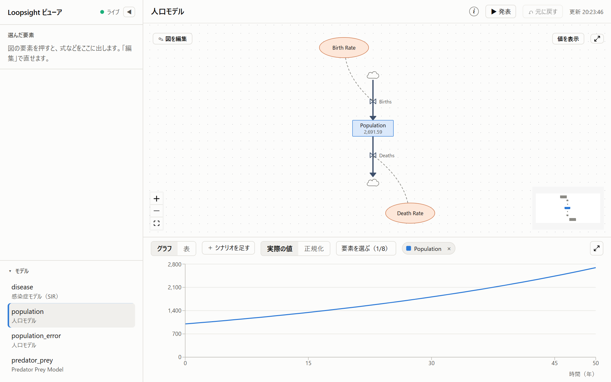

# loopsight

AI アシスタントと一緒にシステムダイナミクス（SD）のモデルを作り、動かし、確かめるための道具。SD を知っている人が、SD を知らない人にも、シミュレーションで問題と解決案を見せられるようにすることを目指している。

- Claude Code などに言葉で頼んで、モデルを作り、実行し、値を変えた場合（シナリオ）と比べられる
- ビューア（ブラウザで開く画面）で、図とグラフを見ながら式の値や配置を手直しできる。AI がモデルを変えると、画面がその場で変わる
- 図だけを SVG と PNG に書き出して、資料に貼れる

> **Claude に入れてもらうこともできる。** Claude Code に、はじめての手順のアドレス（https://github.com/kagu3/loopsight/blob/main/docs/getting-started.md）を貼って「この手順で loopsight を入れて」と頼めば、Claude が代わりに入れるか、あなたがすることを示してくれる。



モデルは [Insight Maker](https://insightmaker.com/) の ModelJSON 形式で保存し、シミュレーションには Insight Maker 公式のエンジン [`simulation`](https://github.com/scottfr/simulation) を使う。insightmaker.com には自動でアクセスしない（利用規約で禁止されているため）。

## 使い方を選ぶ

| 使い方 | 向いている人 | 始め方 |
|---|---|---|
| npm で入れる（`npx`） | Claude Code などの AI と一緒に使う人 | [はじめての手順](docs/getting-started.md) |
| ブラウザ版（予定） | 何も入れずに試したい人 | まだない |

## すぐに始める

Node.js 22 以上と [Claude Code](https://claude.com/claude-code) が必要。ターミナルで、loopsight を Claude Code に登録する。

macOS、Linux、WSL：

```bash
claude mcp add --scope user loopsight -- npx -y loopsight --models-dir ~/loopsight-models
```

Windows（PowerShell）：

```powershell
claude mcp add --scope user loopsight -- cmd /c npx -y loopsight --models-dir $HOME\loopsight-models
```

Claude Code を起動し直して、「人口のモデルを作って。人口は最初 1000 人、出生率 3%、死亡率 1%、50 年」のように頼む。

図とグラフで見るときは、別のターミナルでビューアを起動して、http://localhost:5180/ を開く。

macOS、Linux、WSL：

```bash
npx -y -p loopsight loopsight-viewer --models-dir ~/loopsight-models
```

Windows（PowerShell）：

```powershell
npx.cmd -y -p loopsight loopsight-viewer --models-dir $HOME\loopsight-models
```

Windows での注意や、うまくいったかの確かめ方、よくある失敗は [はじめての手順](docs/getting-started.md) にある。

## ドキュメント

一覧は [docs/README.md](docs/README.md) にある。

- [はじめての手順](docs/getting-started.md)：入れ方から、最初のモデル、ビューア、シナリオの比べ方まで
- [ビューアの使い方](docs/viewer.md)：画面の見方と操作（スクリーンショットつき）
- [ツールのリファレンス](docs/reference/tools.md)：AI が使うツールと引数
- [式の書き方](docs/reference/formulas.md)：要素の式に使える演算子、関数、単位
- [モデルのファイルの形式](docs/reference/model-format.md)：ModelJSON、作業フォルダ、起動引数と環境変数
- [変更履歴](CHANGELOG.md)

## 開発に参加する

clone して動かす方法、テストなどのコマンド、守ってほしい決まりは [CONTRIBUTING.md](CONTRIBUTING.md) にある。

## ライセンス

[GNU Affero General Public License v3.0](LICENSE)（3 以降の版も可）。エンジン `simulation` が AGPL のため、それに合わせている。
