# ビューアの使い方

ビューアは、作業フォルダにあるモデルを図とグラフで見て、手直しするための Web 画面です。AI が MCP でモデルを作ったり変えたりすると、画面がその場で変わります。人は画面で AI が作ったモデルを確かめ、式の値や図の配置、比べる施策を少し直せます。

画面で直した内容は、AI が使っているのと同じファイルに保存されます。要素を足したり消したりする大きな変更は、AI に頼みます。

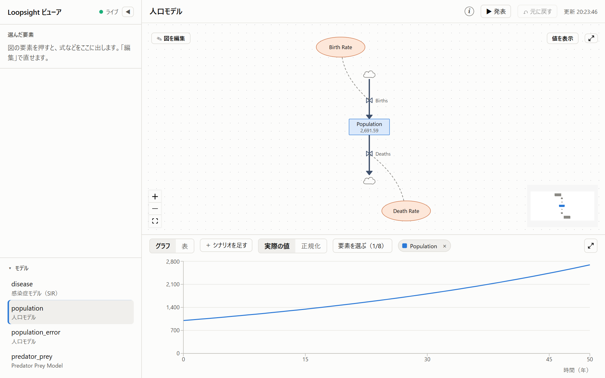

## 目次

- [起動のしかた](#起動のしかた)
- [画面の全体](#画面の全体)
- [図の見方](#図の見方)
- [グラフと表](#グラフと表)
- [発表モード（会議資料）](#発表モード会議資料)
- [要素の詳しい情報](#要素の詳しい情報)
- [要素を編集する](#要素を編集する)
- [編集モード](#編集モード)
- [図の要素を動かす](#図の要素を動かす)
- [元に戻す](#元に戻す)
- [AI と同時に変えたとき](#ai-と同時に変えたとき)
- [AI の変更がその場で反映される](#ai-の変更がその場で反映される)
- [エラーがあるとき](#エラーがあるとき)
- [暗い配色](#暗い配色)
- [困ったとき](#困ったとき)
- [このページのスクリーンショットを撮り直す](#このページのスクリーンショットを撮り直す)

## 起動のしかた

初めて使うときと、プログラムを更新したあとは、ビルドしておきます。

```bash
npm run build
```

ビューアを起動します。

```bash
npm run viewer
```

次のように表示されたら、ブラウザで http://localhost:5180/ を開きます。

```
SD Modeler ビューア: http://localhost:5180/
作業フォルダ: C:\...\sd-modeler\models
```

止めるときは、起動したターミナルで Ctrl+C を押します。

### よくある使い方

1. ビューアを起動して、ブラウザで開いておく
2. Claude Code で、AI にモデルを作ったり変えたりするよう頼む（「人口モデルを作って」など）
3. AI がモデルを保存すると、画面がその場で変わる。図とグラフで中身を確かめる

ビューアと MCP サーバーは別々に動いていて、作業フォルダのファイルだけでつながっています。どちらを先に起動してもかまいません。

### 設定

| 設定 | 決め方 | 既定 |
|---|---|---|
| 作業フォルダ | `--models-dir <フォルダ>`、環境変数 `SD_MODELER_MODELS_DIR` の順 | 起動したフォルダの `models/` |
| ポート | `--port <番号>`、環境変数 `SD_MODELER_VIEWER_PORT` の順 | 5180 |

作業フォルダの決め方は MCP サーバーと同じです。MCP サーバーと違うフォルダを見ていると、AI の変更が画面に出ません。

```bash
npm run viewer -- --models-dir D:/work/models --port 5181
```

ビューアは自分の PC の中（`127.0.0.1`）でだけ動きます。ほかの PC やスマートフォンからは開けません。

## 画面の全体

| 場所 | 内容 |
|---|---|
| 左上 | 「ライブ」の緑の点は、ファイルの変更を見張っている印です。灰色の「未接続」なら、ビューアが止まっています |
| 左の「選んだ要素」 | 図の要素を押すと、式などの詳しい情報が出ます。よく使うので、いちばん上にあります（[要素の詳しい情報](#要素の詳しい情報)） |
| 左の「問題」 | モデルにエラーや警告があるときだけ出ます（[エラーがあるとき](#エラーがあるとき)） |
| 左下の「モデル」 | 作業フォルダのモデルの一覧です。上の行がファイル名、下の行がモデルの名前です。押すとそのモデルを開きます。見出しを押すと一覧を閉じたり開いたりできます（閉じているあいだはモデルの数を出します）。開け閉めはブラウザが覚えています |
| 上の帯 | モデルの名前と説明、「✎ 編集モード」（[編集モード](#編集モード)の切り替え）、「▶ 発表」（[発表モード](#発表モード会議資料)を別のタブで開く）、「元に戻す」、最後に読み込んだ時刻 |
| 真ん中 | モデルの図です（[図の見方](#図の見方)） |
| 下 | 実行結果のグラフと表です（[グラフと表](#グラフと表)） |

開いているモデルは、アドレスの `#` のあとに出ます（例：`http://localhost:5180/#population`）。このアドレスをブックマークしておくと、そのモデルを直接開けます。何も指定しないと、いちばん最近変わったモデルを開きます。

## 図の見方

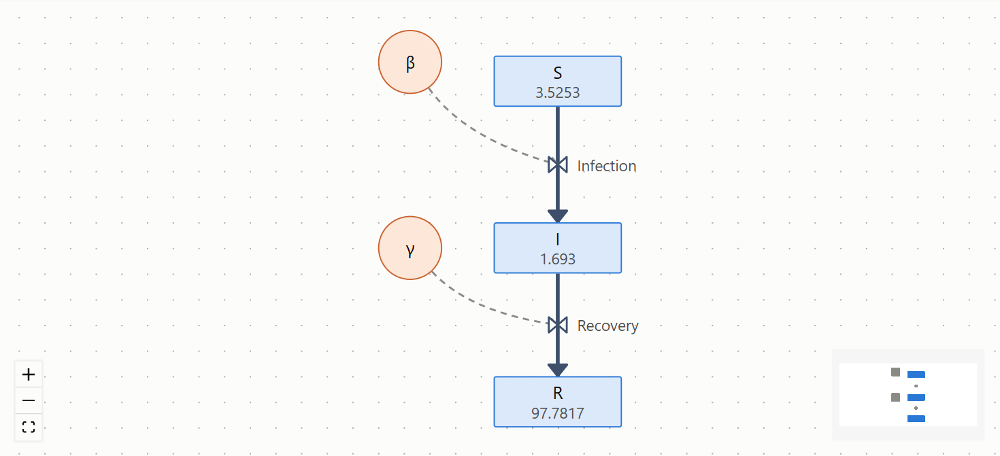

| 形 | 要素 | 説明 |
|---|---|---|
| 青い四角 | ストック | たまっている量（人口、在庫など）。下の小さい数字は、実行の最後の値です |
| 橙の楕円 | 変数 | 決まった値や、式で計算する値 |
| 緑の角が丸い四角 | コンバーター | 表で入力を出力に変える要素 |
| 紫の角が丸い四角 | 状態 | 状態（STATE） |
| 太い線と ⋈ | フロー | ストックに出入りする流れ。⋈（弁）の横にフローの名前が出ます。矢印の向きに流れます |
| 雲 | モデルの外 | フローの出元や行き先がモデルの外のとき |
| 点線の矢印 | リンク | 「この要素の値を、矢印の先の式で使う」というつながり。`+` `-` は極性です |

箱の幅は名前の長さで決まります。とても長い名前は、言葉の切れ目で 2 行に分けます（2 行まで）。モデルに大きさ（`display.size`。Web 版から取り込んだモデルなど）があれば、その大きさで描きます（名前が入りきらないときは、箱の中で折り返します）。`view_diagram` で重なりを確かめるときも、同じ大きさを使います。

### 図の操作

開いたときは、図が欄に入るように合わせます。ただし名前が読める大きさより小さくはしません。それで全体が入らないときは、ストックが入るように合わせます。ほかの要素はドラッグかミニマップで動かして見ます。

- **見る場所を動かす：** 図の何もないところをドラッグします
- **拡大・縮小：** マウスのホイールか、左下の `+` `−` を押します
- **全体を表示：** 左下の `⛶` を押すと、図全体が入るように戻ります。大きな図は名前が読める大きさまでしか縮めないので、はみ出したところはドラッグかミニマップで見ます
- **ミニマップ：** 右下の小さな図が全体です。四角が今見ているところです。ミニマップの上でドラッグすると見る場所が動き、ホイールで拡大・縮小します
- **要素を選ぶ：** 要素を押すと青い枠が付き、左に詳しい情報が出ます。図では、その要素に出入りする線とつながる相手だけをふつうに出し、ほかは薄くします（フローなら弁、両端、弁につながるリンクとその相手。ストックなら出入りするフローとその先の端、リンクの相手。変数ならリンクの相手で、相手がフローなら弁だけ）。何もないところを押すと選ぶのをやめ、元に戻ります
- **線を選ぶ：** リンク（点線の矢印）を押すと線が青くなり、左に何から何へのリンクかが出ます。図では、その線と両端の要素だけをふつうに出します。フローの線を押すと、そのフローを選びます。線の上からドラッグしても見る場所は動かないので、何もないところからドラッグします
- **要素を動かす：** [編集モード](#編集モード)をオンにして、要素をドラッグします。離すと位置を保存します（[図の要素を動かす](#図の要素を動かす)）。オフのときは、要素をドラッグしても要素は動かず、図全体の見る場所が動きます

### 配置

モデルに座標（図の上の位置）があれば、そのとおりに描きます。Insight Maker の Web 版から取り込んだモデルは、Web 版と同じ並びになります。

座標のない要素が 1 つでもあると、その要素だけを簡易レイアウトで仮に並べます（Web 版に書き出すときと同じ並べ方です）。上の帯に「座標のない要素を仮に並べています」と出ます。仮の並びはファイルに保存しませんが、編集モードで要素を 1 つでも動かすと、そのとき見えている配置をまとめて保存します。

配置を整えるときは、次の 2 つの方法があります。

- **自分で動かす：** 編集モードで要素をドラッグします（[図の要素を動かす](#図の要素を動かす)）
- **AI に頼む：** 「図の配置を整えて」「線が交差しないように並べ直して」などと頼みます。AI は `view_diagram` で、このビューアと同じ描き方の図の画像と、箱の重なり・線が要素や名前の上を通るところ・線の交差・1 か所に集まる線の一覧を見ながら、位置を直します。直すたびに、開いているビューアにもその場で出ます

### ループを目立たせる

AI は `find_loops` でフィードバックループを探し、`view_diagram` の `loop` で、そのループを目立たせた図の画像を見られます。ループの要素と線だけをふつうに出してほかを薄くし、ループの線を太くします（強めるループ R は赤、釣り合わせるループ B は青、R か B か決まっていなければ灰色）。図の左上に、ループの名前と R / B を出します。発表モードの「原因」のスライドも、同じ表示です。

## グラフと表

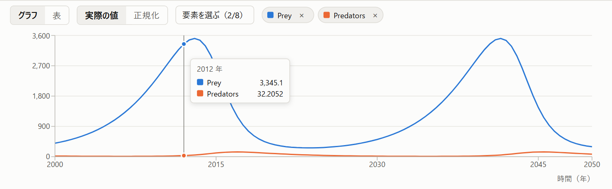

下の欄には、モデルを実行した結果を出します。横軸は時間で、単位はモデルの設定（年、週など）です。

- **最初に出る要素：** モデルにグラフの設定があれば、その要素を出します。なければストックを出します
- **凡例：** 上の帯には、グラフに出している要素だけを、線と同じ色で並べます。名前の横の × を押すと、その要素をグラフから外します。帯は 1 行で、入りきらないときは名前を「…」で省略します（カーソルを乗せると全部出ます）。それでも入りきらないときは、帯を横にスクロールして見ます
- **要素を選ぶ：** 「要素を選ぶ（2/8）」を押すと一覧が開きます。括弧の中は、出している本数と出せる本数です。一覧はストック、フロー、変数ごとにまとめてあり、チェックを付けるとグラフに出ます。上の欄に名前の一部を入れると絞り込めます（空白で区切ると、すべての言葉を含む名前に絞ります）。Esc か、一覧の外を押すと閉じます
- **同時に出せるのは 8 本まで：** 8 本出しているときは、一覧のほかの要素は選べなくなります。1 本外すと選べるようになります
- **色は要素ごとに決まる：** ほかの要素を出し入れしても、出ている線の色は変わりません
- **値を読む：** グラフの上にカーソルを乗せると、その時刻の値が出ます
- **正規化：** 「実際の値」と「正規化」で縦軸を切り替えられます。正規化にすると、要素ごとに最小を 0%、最大を 100% にそろえて出します。大きさの違う要素（人口と出生率など）の、増え方や減り方の形を比べたいときに使います。カーソルを乗せて出る値は、正規化していても実際の値です。ずっと同じ値の要素は 50% の高さに平らに出ます。どちらにしたかはブラウザが覚えています

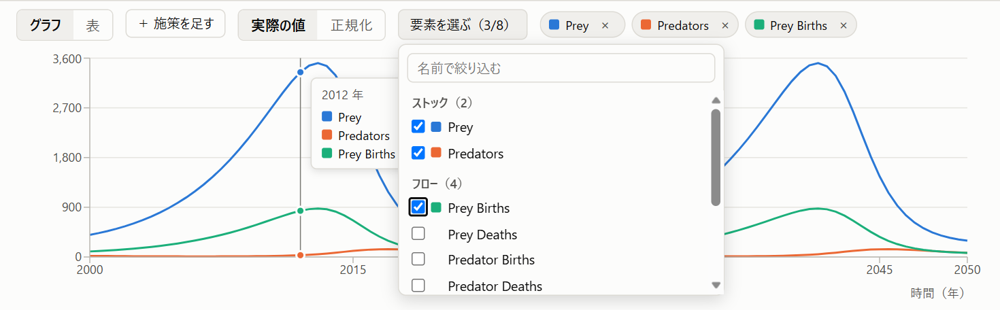

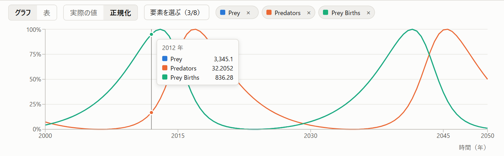

### 表

「表」を押すと、同じ要素を数字の表で見られます。正確な値を確かめたいときに使います。列は、上で選んだ要素です。

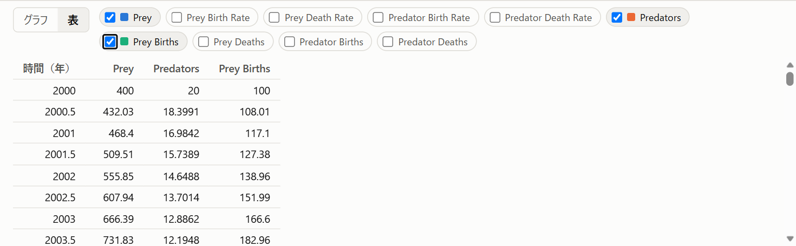

### 施策を比べる

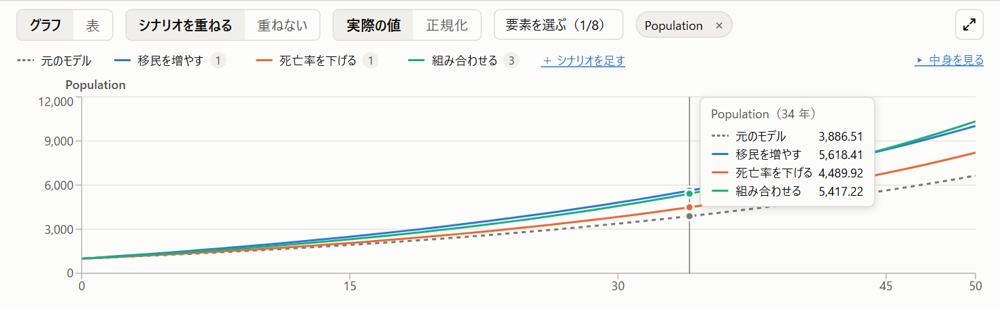

モデルに施策（シナリオ）が保存されていると、グラフは要素ごとに分かれ、それぞれに「何もしない場合」と施策を重ねて出します。施策は画面で足せます（[施策を直す](#施策を直す)）。AI に頼んでも保存できます（MCP の `set_scenarios`）。たとえば「出生率を 4% に上げる施策と、移民を受け入れる施策を保存して」と頼みます。

- **何もしない場合：** モデルの値を何も変えずに実行した結果です。灰色の点線で出します
- **施策の色：** 施策ごとに色が決まります。グラフの上の帯が施策の凡例です。施策の名前の横の小さな数字は、その施策で変えた値の数です。カーソルを乗せると、施策の説明と、変える値が出ます。同時に重ねられる施策は 8 つまでです。9 つ目からはグラフに出さず、そのことを凡例の下に出します
- **要素を選ぶ：** 「要素を選ぶ」で選んだ要素ごとに、小さなグラフが並びます。入りきらないときは、グラフの欄を縦にスクロールします
- **値を読む：** グラフの上にカーソルを乗せると、その時刻の、どの施策の値も出ます
- **正規化：** 要素ごとに、どの施策も通した最小を 0%、最大を 100% にそろえます。施策どうしの高さの違いはそのまま比べられます
- **表：** 列は「要素 × 施策」です。施策の凡例の帯も、グラフのときと同じように出ます
- **重ねない：** 「重ねない」を押すと、施策を保存する前と同じ、何もしない場合だけのグラフに戻ります
- **その場で変わる：** AI が施策の値を変えたり、施策を足したり消したりすると、グラフがその場で変わります。実行できない施策があると、グラフの上にその理由を出します

#### 施策の中身を表で比べる

帯の右端の「▸ 中身を見る」を押すと、凡例が開いて、施策ごとに「何を、どれだけ変えたか」と「結果」を並べた表になります。施策が 2 つ以上あるときや、1 つの施策で値をいくつも変えているときに、施策の違いが一目でわかります。

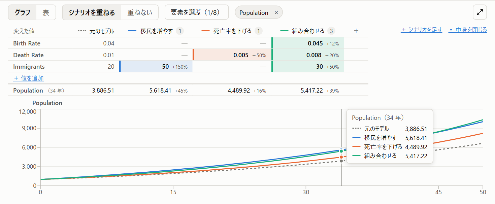

- **列：** 凡例がそのまま列の見出しになります。「何もしない場合」と、グラフに重ねている施策です（並びと線の色は凡例と同じ）。実行できなかった施策と、色が足りずに出していない施策は、列に入れません
- **変えた値の行：** どれかの施策で変えた要素だけを、モデルの並び順で出します。何も変えていない要素は出しません
  - 「何もしない場合」の列は、いまのモデルの値です。ストックは初期値（行の見出しに「初期値」と出ます）、変数とフローは式です
  - 施策の列は、その施策で変えていれば施策の値を、施策の色を付けて出します。変えていなければ「—」を薄く出します
  - 両方が数なら、「何もしない場合」からの変化を添えます（例：`+50%`、`−25%`）。0 からの変化など率にできないときは差（例：`+2`）を添えます。式のときは添えません
- **結果の行：** 最後の行は、グラフで選んでいる要素の、最後の時点の値です。施策の列には「何もしない場合」からの変化を添えます。グラフにカーソルを乗せている間は、その時点の値に変わります（行の見出しに、要素の名前と時点を出します。例：`Population（34 年）`）。要素を複数選んでいるときは、要素ごとに 1 行です
- **行が多いとき：** 変えた値が 6 行を超えると、超えたぶんを畳んで「ほか N 件」と出します。押すと開きます
- **施策を直す・足す：** 開いているときも、列の見出しの施策の名前を押すと左の欄で直せます（[施策を直す](#施策を直す)）。「＋ 施策を足す」は帯の右に出ます
- **幅が足りないとき：** 表を横にスクロールします。グラフの幅は変わりません
- **閉じる：** 「▾ 中身を閉じる」で元の凡例に戻ります。開いているか閉じているかはブラウザが覚えていて、次に開いたときも同じです

#### 図のどこを変えたかを見る

施策の凡例（開いているときは表の列の見出し）にカーソルを乗せている間は、図の中の「その施策で変えた要素」に小さな札を付けます。施策が図のどこに手を入れたのかが、図の上でわかります。

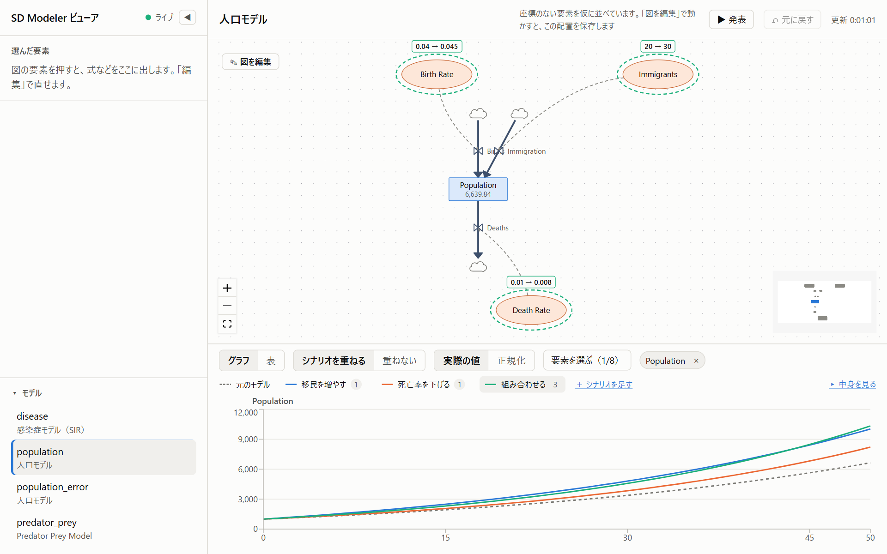

- **札の中身：** 「いまの値 → 施策の値」です（例：`20 → 50`）。ストックは初期値で、札に「初期値」と添えます。長い式は省略します。要素にカーソルを乗せると、全文が出ます
- **色：** 札と要素の点線の枠は、その施策の線の色です。選んだ要素の枠や、ループを目立たせたときの線とは別に、外側に点線で描くので、重なっても見分けられます
- **施策を直している間：** 左の欄で施策を直している間も、その施策の札を付けます。札に出すのは保存してある値で、入れている途中の値ではありません。実行できなかった施策や、色が足りずにグラフに出していない施策は、灰色で付けます
- **出さないとき：** 「何もしない場合」に乗せたときは何も出しません。普段（施策に注目していないとき）も出しません
- **図の操作：** 札が付いている間も、要素を選ぶ・拡大縮小はいつもどおりできます（編集モードなら動かすこともできます）。変えた要素が図の見えている範囲の外にあっても、図は動かしません

### 施策を直す

グラフの上の帯で施策の名前を押すと、左の欄が施策の編集欄になります（要素の「編集」と同じ場所です）。施策を足すときは「＋ 施策を足す」を押します。施策がまだないときや「重ねない」にしているときは、グラフの上の「＋ 施策を足す」から足せます。

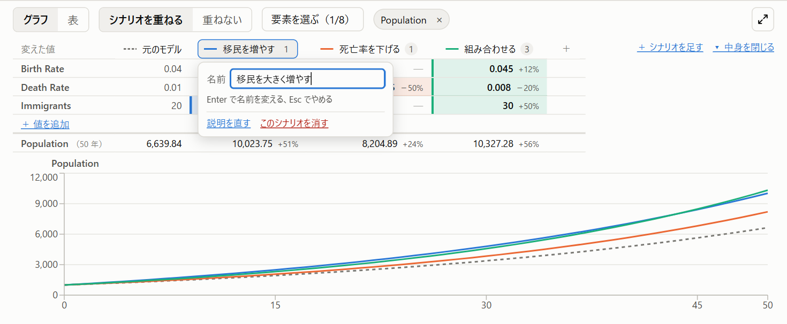

- **名前と説明：** 説明には、どんな施策かを書きます。発表モードの解決案のスライドにも出ます。「何もしない場合」と、ほかの施策と同じ名前は使えません
- **変える値：** 1 行に「要素・この施策の値・いま（何もしない場合の値）」を並べます。要素はストック（初期値）、変数、フローから選びます。値は数字か式で入れます（例：`[Birth Rate]*2`）。「＋ 行を足す」で行を足し、× で行を消します。1 つの施策の中で、同じ要素は 1 行だけです
- **保存：** 「保存」か Ctrl+Enter で、モデルの `scenarios` に保存し、グラフをその場で描き直します。「やめる」か Esc で、保存せずに閉じます
- **施策を消す：** 「この施策を消す」を押し、確かめの「消す」を押すと消します
- **名前を変えたとき：** 会議資料の筋書きの中の施策の名前も直します（[発表モード](#発表モード会議資料)）
- **8 つを超えるとき：** 9 つ目からの施策も保存できますが、グラフには出ません。編集欄にそのことを出します

名前の重なり、ない要素、値を変えられない要素は、AI が `set_scenarios` で保存したときと同じように確かめ、誤りがあれば保存せずに、編集欄に理由を出します。値の式の誤り（参照する名前の打ち間違いなど）は、保存したうえで、グラフの上に「実行できませんでした」と理由を出します。

### 値の見方の注意

- 縦軸は 1 本だけです。大きさの違う要素（人口と出生率など）を「実際の値」で一緒に出すと、小さいほうは 0 の近くにつぶれて見えます。そのときは「正規化」に切り替えるか、片方ずつ見てください
- 正規化したグラフでは、線どうしの高さで大きさは比べられません（どの線も 0% から 100% に広がるため）。大きさを比べるときは「実際の値」か表で見てください
- 数字は、絶対値が 100 以上なら小数 2 桁まで、それより小さければ 4 桁までに丸めて出します。とても大きい値や小さい値は `1.234e+9` のような形になります

### 実際のデータを重ねる

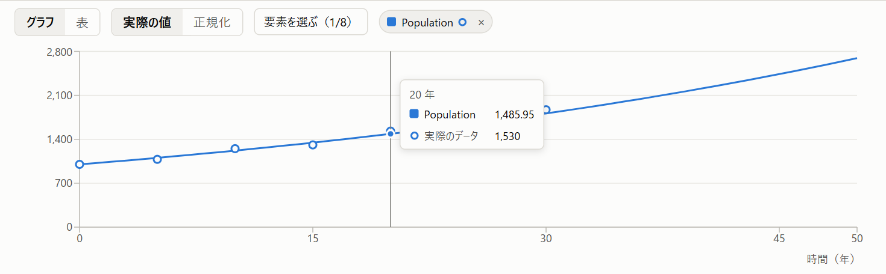

実際のデータ（売上の実績や観測値など）があると、グラフの要素の線に、同じ色の白抜きの丸で重ねて出します。モデルが、問題になっている振る舞いを再現できているかを見比べるのに使います。

- **データの置き場所：** 作業フォルダの `<モデル名>.data.csv` です。1 行目は見出しで、1 列目が時刻、ほかの列が要素名です。空欄は値なしとして扱います。モデルの一覧には出ません
- **取り込み方：** AI に「この CSV を実際のデータとして取り込んで」と頼みます（`import_data`）。Excel から貼った表（タブ区切り）でも読めます。ファイルを Excel などで直接書き換えて保存してもかまいません。画面はその場で変わります
- **値を読む：** データのある時刻にカーソルを乗せると、モデルの値の下に「実際のデータ」の値が出ます。凡例の名前の横の白抜きの丸は、その要素にデータがあることを示します
- **列名が要素名と合わないとき：** 左の「問題」に警告として出し、似た名前があれば「もしかして」を添えます。合わない列は描きません。時刻がシミュレーションの期間と重ならないときも知らせます
- **名前を変えたとき：** 要素の名前を変えると（AI に頼んでも、画面で変えても）、CSV の列名も直します（見出しの行だけを書き換え、値はそのまま残します）。「元に戻す」で名前を戻すと、列名も戻します。CSV を Excel などで開いていて直せなかったときは、名前の変更は保存したうえで、黄色の帯で知らせます。そのときは列名を手で直してください
- **施策を重ねているとき：** 要素ごとのグラフにも、データの点を重ねます。線の色は施策を表すので、点は文字と同じ色の白抜きの丸にします
- **正規化したとき：** データの点は、モデルの線と同じ目盛り（モデルの最小が 0%、最大が 100%）で出します。そのため、データが 0% から 100% の外に出ることがあります

## 発表モード（会議資料）

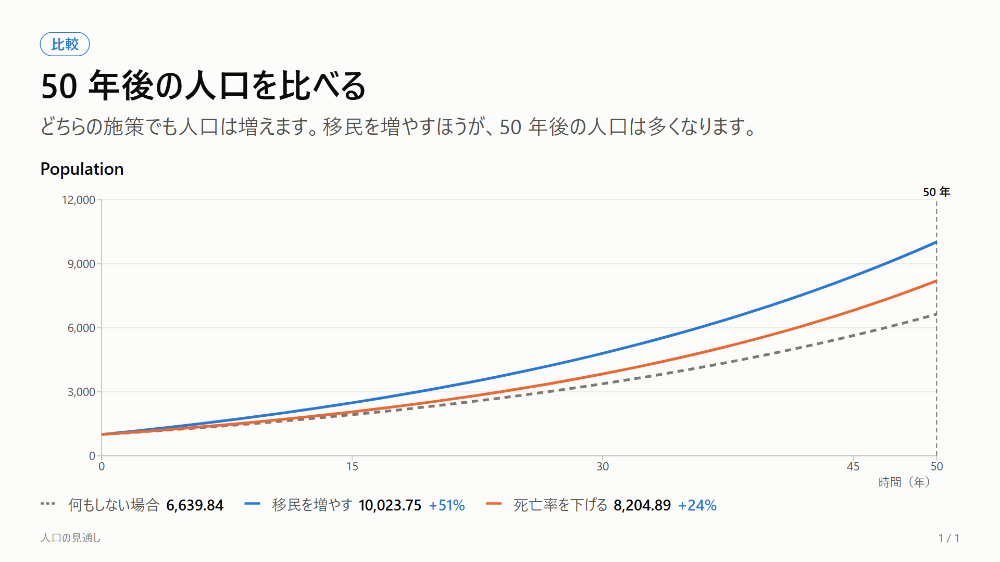

発表モードは、SD を知らない人に、問題と解決案を順に見せるための画面です。会議では、SD を知っている人がこの画面を映して説明します。作業画面はそのまま残ります。

- **開き方：** 上の帯の「▶ 発表」を押すと、別のタブで開きます。アドレスは `http://localhost:5180/?view=present#<モデル名>` です
- **筋書きの作り方：** スライドは画面では作りません。Claude Code で、AI に「会議資料を作って」と頼みます。AI が MCP の `set_slides` で筋書きを作業フォルダの `<モデル名>.slides.json` に保存し、`view_slides` で 1 枚ずつ画像にして確かめます。直したいところも AI に頼みます
- **進め方：** → か Space で次へ、← で前へ進みます。Home で最初、End で最後に移ります。F で全画面になります（もう一度 F か Esc で戻ります）。マウスを乗せると、右下に移動のボタンが出ます。何枚目かはアドレスの `slide=` に入るので、読み直しても同じスライドから始まります
- **出さないもの：** 式、編集の欄、問題の一覧は出しません。グラフの縦軸は実際の値です
- **その場で変わる：** 開いたまま AI が筋書きやモデルを直すと、すぐに変わります

スライドは、問題 → 原因 → 解決案 → 比較 → 結論 の順に並べます。どのスライドにも、見出しと「言いたいこと」の 1 文が出ます。

| 種類 | 出すもの |
|---|---|
| 問題 | 注目する要素のモデルの線に、実際のデータ（`<モデル名>.data.csv`）を白抜きの丸で重ねます。「今」の時点に縦の点線を引きます |
| 原因 | 左にストックとフローの図、右にループをひと回りする要素の名前。図では、ループの要素と線だけを目立たせてほかを薄くし、左上に強めるループ（R）か釣り合わせるループ（B）かを出します（[ループを目立たせる](#ループを目立たせる)） |
| 解決案 | 施策の名前と説明（`set_scenarios` で保存した説明）、変える値の「いま」と「この施策」 |
| 比較 | 要素ごとに「何もしない場合」（灰色の点線）と施策を重ね、注目する時点に縦の点線を引きます。下に、その時点の値と「何もしない場合」と比べた変化（−39% など）を並べます |
| 結論 | 文章だけ |

- **名前を変えたとき：** 要素や施策の名前を変えると（AI に頼んでも、画面で変えても）、筋書きの中の名前も直します。「元に戻す」で名前を戻すと、筋書きも戻します
- **筋書きが合わなくなったとき：** 筋書きが使っている要素や施策を消すと、作業画面の左の「問題」に警告が出ます。発表モードでは、そのスライドに「〜がモデルにありません」と出ます。AI に直してもらいます

## 要素の詳しい情報

図の要素を押すと、左の「選んだ要素」に詳しい情報が出ます。フローは、⋈（弁）か名前を押します。

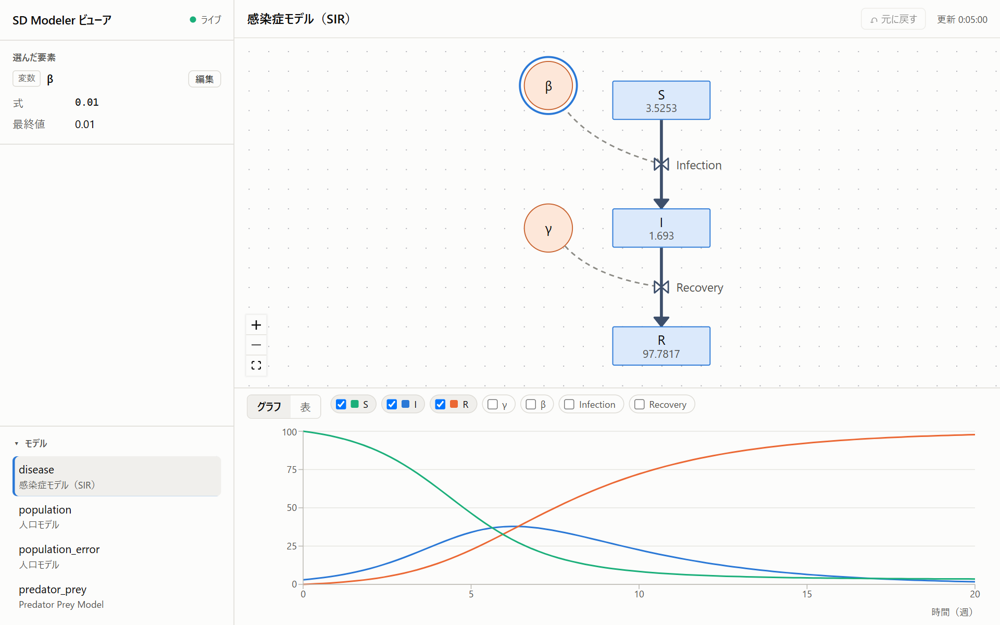

| 項目 | 内容 |
|---|---|
| 種類と名前 | ストック、変数、フローなど |
| 流れ | フローの出元と行き先（モデルの外は「（外）」） |
| 初期値 | ストックの最初の値（式のこともあります） |
| 式 / 流量 | 変数の式、フローの流量の式 |
| 入力・表 | コンバーターの入力と変換の表 |
| 単位 | 単位があれば |
| 最終値 | 実行の最後の値 |

## 要素を編集する

選んだ要素の「編集」を押すと、左の欄で値を直せます。直せるのはストック、変数、フロー、コンバーターです。[編集モード](#編集モード)に関係なく、いつでも使えます。

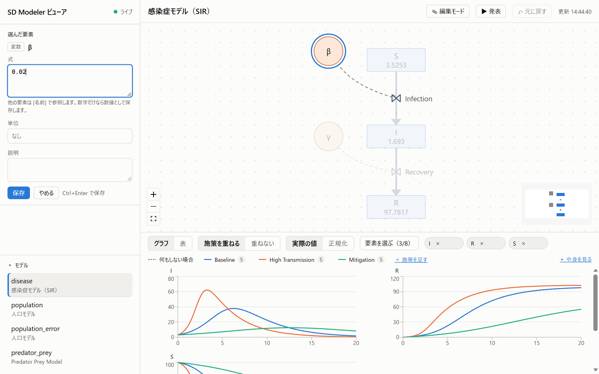

| 要素 | 直せる項目 |
|---|---|
| ストック | 初期値、単位、負にしない、説明 |
| 変数 | 式、単位、説明 |
| フロー | 流量、単位、負にしない、説明 |
| コンバーター | 表（1 行に「入力, 出力」）、単位、説明 |

- 式の中では、ほかの要素を `[名前]` で参照します（例：`[Population]*[Birth Rate]`）。数字だけなら数値として保存します
- 「保存」か Ctrl+Enter で保存します。「やめる」か Esc で、直す前に戻ります
- 保存すると、すぐにモデルを実行し直して、図の最終値とグラフが変わります
- 式で新しい要素を参照すると、足りないリンク（点線の矢印）を自動で足します。AI が `upsert_elements` で直したときと同じです
- 式に誤りがあっても保存はします。左の「問題」にエラーが出るので、直してください

状態と遷移は編集できません。名前の変更もまだできないので、AI に頼みます。要素を足す・消す、線（リンク）を引く・消すのは、[編集モード](#編集モード)でできます。施策は画面で足したり直したりできます（[施策を直す](#施策を直す)）。

## 編集モード

図の形を変える操作は、上の帯の「✎ 編集モード」をオンにしたときだけできます。見るだけのときに、うっかり図を崩さないためです。

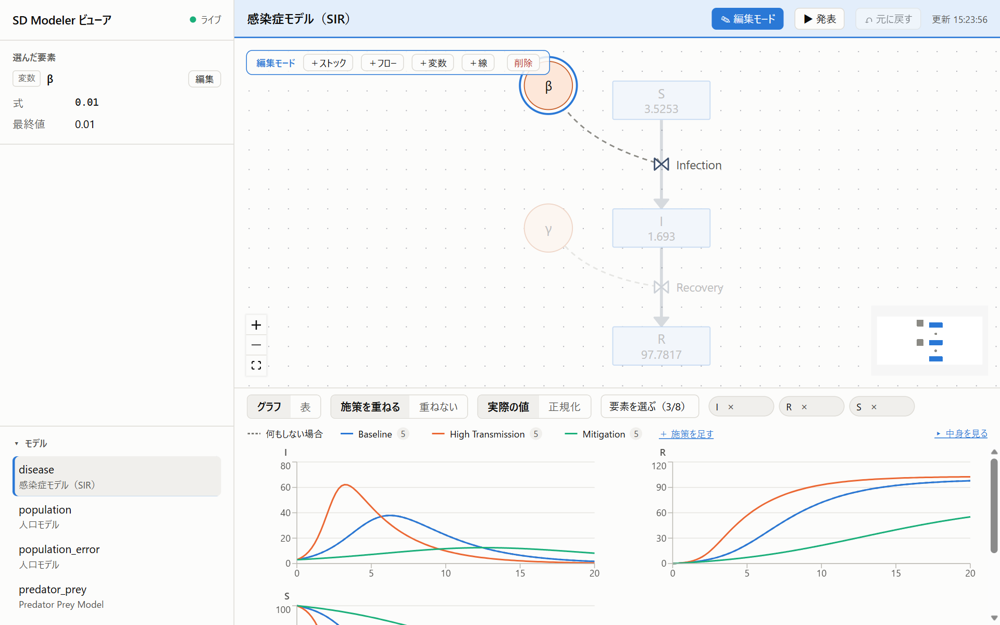

| | できること |
|---|---|
| いつでも | 要素や線を選ぶ、見る場所を動かす・拡大縮小する、要素の中身を直す（左の「編集」）、施策を直す、元に戻す |
| 編集モードのときだけ | 図の要素を動かす（[図の要素を動かす](#図の要素を動かす)）、要素を足す・消す、線（リンク）を引く・消す |

- 押すたびにオンとオフが切り替わります。オンの間は上の帯の色が変わり、図の左上に「編集モード」と、要素を足す・線を引く・消すボタンが出ます。要素が図の左上の角にあるモデルでは、この帯が要素に重なることがあります。帯は少し透けているので下の要素も見えますが、見にくければ見る場所を動かします
- ビューアを開いたときは、いつもオフです（前に開いたときの状態は覚えません）
- AI の変更は、編集モードに関係なく、その場で画面に出ます
- 発表モードと、AI が使う図だけの表示（`view_diagram`）には出ません。どちらも図の要素は動かせません

### 要素を足す

図の左上の「＋ストック」「＋フロー」「＋変数」を押してから、図の置きたい場所を押します。その場所に「新しいストック」のような仮の名前で置き、選んだ状態にします（同じ名前があれば「新しいストック 2」のように番号を付けます）。値は 0 です。名前や式は、左の「編集」で直します。

- ボタンを押したあと、置きたい場所を押すまでは、ボタンの色が変わり、カーソルが十字になります。やめるときは Esc を押すか、同じボタンをもう一度押します
- フローは、両端を雲（モデルの外）にして横向きに置きます。フローの端をストックにつなぎ替える操作はまだないので、AI に頼みます
- 足した要素はすぐにファイルに保存するので、AI からも見えます。AI の編集（`upsert_elements`）と同じ確かめを通ります
- 足したり消したり（それを元に戻したり）しても、図の見る場所は動かしません。AI が要素を足したり消したりしたときは、全体が入るように合わせ直します

### 要素を消す

図で要素を選んでから、図の左上の「削除」を押すか、Delete キー（Mac は fn + delete）を押します。文字を消すつもりで押されやすい Backspace（Mac の delete）では消しません。

- つながっているリンクも一緒に消えます
- ストックを消すと、出入りするフローは残し、その端を雲（モデルの外）にします。雲は消したストックのあった場所に置きます（入るフローと出るフローの雲が重ならないよう、それぞれのフローの向きに少しずらします）。フローも消したいときは、続けてフローを選んで消します
- フローを消すと、両端の雲と弁も消えます
- 消した要素をほかの要素の式が使っていた、施策で値を変えていた、といったときは、何をしたかを黄色の帯で知らせます。施策の中の、その要素の値は消えます。式は直さないので、左の「問題」にエラーが出ます。式を直すか、「元に戻す」で戻します（戻すと帯も閉じます）
- 実際のデータの列や、会議資料の筋書きの中の名前はそのまま残します。合わなくなったところは、左の「問題」に警告が出ます（元に戻せば合います）
- 選んでいない、状態か遷移を選んでいる、左の欄で施策を直している、のどれかのときは、「削除」は押せません
- 線（リンク）を消すときは、[線（リンク）を引く・消す](#線リンクを引く消す)を見てください
- 左の欄（詳細欄の入力欄や「保存」のボタンなど）にいるときの Delete キーでは消しません。打ちかけの内容を失わないためです
- AI の削除（`remove_elements`）と同じ処理を通ります。「元に戻す」で戻せます

### 線（リンク）を引く・消す

リンク（点線の矢印）は、「この要素の値を、矢印の先の式で使う」というつながりです。編集モードで、次のどちらかの方法で引きます。

- **ドラッグ：** 元の要素の縁（箱や丸のすぐ外側）にマウスを乗せると、縁に色が付き、カーソルが十字になります。そこからドラッグして、先の要素の上で離します。引いている間は点線が付いてきて、離せる要素には枠が付きます。何もないところで離すと、何も引きません。フロー（⋈）から引くときは、下の「＋線」を使います
- **[＋線]：** 図の左上の「＋線」を押してから、元の要素 → 先の要素の順に押します。元の要素には点線の枠が付きます。やめるときは Esc を押すか、何もないところを押します

引いたリンクはすぐにファイルに保存し、選んだ状態にします。AI の編集（`upsert_elements` で LINK を足す）と同じ処理を通ります。

- フローにつなぐときは、⋈（弁）に向けて引きます。雲（モデルの外）にはつなげません
- 同じ向きのリンクがすでにあるとき、自分自身に引こうとしたときは、引かずに理由を黄色の帯で知らせます。逆向きのリンクは別のリンクなので引けます
- 極性（`+` `-`）は画面では付けられません。AI に頼みます
- 式で使う要素のリンクは、式を保存したときに自動で足されます（[要素を編集する](#要素を編集する)）。画面で引くのは、式を書く前につながりを描いておくときなどです

編集モードの間は、要素の縁が線を引き始める場所になります。線の端（矢じりや、ストックに出入りする管）が要素の縁に重なるところを押すと、線ではなく要素が選ばれます。線は、端から少し離れたところを押して選びます。

消すときは、リンクの線を押して選んでから、図の左上の「削除」を押すか、Delete キーを押します。「元に戻す」で戻せます。

- 先の要素の式が元の要素を使っている（`[元の要素]` と書いてある）リンクは消せません。消すと式がエラーになり、次に要素を直したときに自動で付け直されるためです。コンバーターの入力元からのリンクも消せません。選んだときに左の欄に理由が出て、「削除」は押せません。先に式（入力）を直します

## 図の要素を動かす

[編集モード](#編集モード)をオンにすると、ストック、変数、コンバーター、雲（モデルの外）をドラッグで動かせます。マウスを離すと、その位置をファイルに保存します。

- フローの ⋈（弁）は、両端の真ん中についてきます。弁だけを動かすことはできません
- 座標のない要素があるモデル（AI が作ったばかりのモデルなど）で動かすと、見えている配置をまとめて保存します
- 要素を図の左や上の端より外に動かすと、全体をずらして保存します。Insight Maker の Web 版に読み込んだときに、画面の外に出ないようにするためです

保存した位置は、AI の `export_model` で Web 版に書き出すときにもそのまま使われます。箱の大きさも、ビューアと同じものを書き出すファイルに入れます。

## 元に戻す

上の帯の「↶ 元に戻す」か Ctrl+Z（Mac は ⌘Z）で、画面で変えたことを 1 つずつ元に戻せます。式の変更も、要素の移動も、要素を足す・消すことも、施策の変更（足す・直す・消す）も戻せます。編集モードに関係なく使えます。施策の名前を戻すと、筋書きの中の名前も戻します。

- 戻せるのは、この画面（ビューア）で変えたことだけです。AI が変えたことは戻せません（AI に頼みます）
- 画面で変えたあとに AI がモデルを変えていたら、戻しません。AI の変更を消してしまわないためです。そのときは、そのことを知らせます
- 覚えておくのは、モデルごとに 50 回分です。ビューアを起動し直すと、元に戻せる記録は消えます
- 入力欄で打っているあいだの Ctrl+Z は、入力欄の文字を戻します

## AI と同時に変えたとき

画面と AI が同じモデルを同時に変えても、片方の変更が黙って消えることはありません。

- **画面で保存したときに、AI が先にファイルを変えていたとき：** 保存せずに最新の内容を読み直し、上に黄色の帯で知らせます。変わった要素には橙色の枠が付きます。内容を確かめてから、もう一度直してください
- **編集しているあいだに、AI が同じ要素を変えたとき：** 「保存」を押すと、保存せずに「編集しているあいだに、ほかのところ（AI など）でこの要素が変わりました」と知らせ、いまの値を出します。それでも自分の内容にしたいときは、もう一度「保存」を押すと上書きします
- **編集しているあいだに、AI がほかの要素を変えたとき：** そのまま保存できます。AI の変更も残ります
- **施策を編集しているときも同じです：** AI が先にファイルを変えていたら黄色の帯で知らせ、同じ施策を変えていたら「この施策が変わりました」と知らせます。もう一度「保存」を押すと上書きします

## AI の変更がその場で反映される

AI が MCP でモデルを保存すると、すぐに画面が変わります。変わった要素や増えた要素は、2〜3 秒のあいだ**橙色の枠**で示します。図の見えている範囲は、要素が増えたり減ったりしたときだけ合わせ直します。値が変わっただけなら、拡大や位置はそのままです。

下は、AI に「出生率を 4% にして、毎年 20 人の移民を足して」と頼んだあとの画面です。変えた Birth Rate と、新しく足した Immigrants と Immigration に枠が付いています。グラフと、ストックの最終値も新しい結果に変わっています。

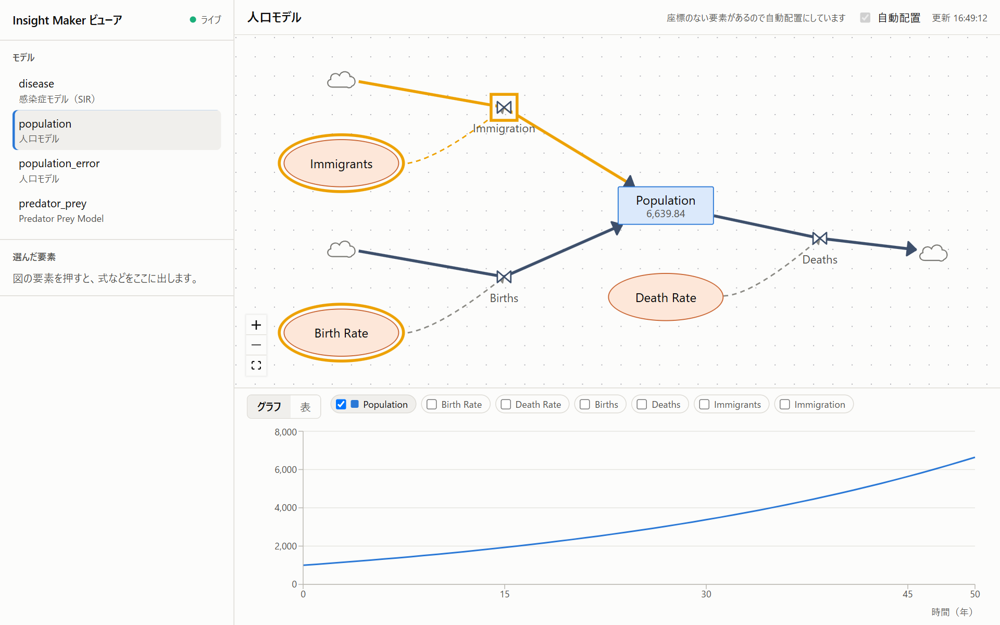

メモ帳などでファイルを直接書き換えたときも、同じように反映されます。

## エラーがあるとき

モデルにエラーがあると、左に「問題」が出ます。エラーがあるあいだは実行しないので、グラフは出ません。図は、エラーがあっても描きます。

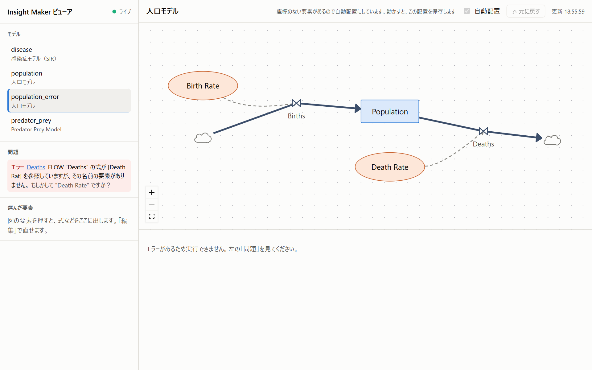

- **エラー（赤）：** このままでは実行できない問題です。式の名前の打ち間違いなどです。「もしかして」のあとに、直し方の候補が出ることがあります
- **警告（黄）：** 実行はできるが、確かめたほうがよいことです
- **要素の名前（下線つき）：** 押すと、その要素を選んで詳しい情報を出します

直すときは、エラーの内容を AI に伝えて頼みます。AI もツールの結果で同じエラーを受け取っているので、たいていは自分で直します。直してファイルが保存されると、「問題」は消えてグラフが出ます。

## 暗い配色

パソコンの設定が暗い配色（ダークモード）なら、画面も暗い配色になります。切り替えのボタンはなく、OS やブラウザの設定に合わせます。

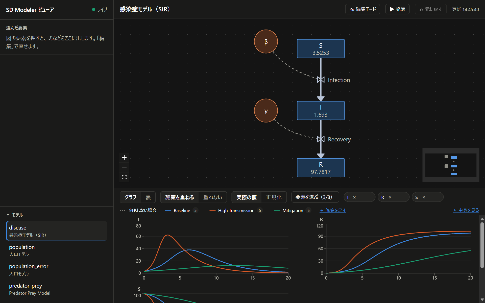

## 困ったとき

| 症状 | 確かめること |
|---|---|
| 「画面がビルドされていません」と出る | `npm run build` を実行してから、もう一度 `npm run viewer` を起動します |
| 「モデルがありません」と出る | 作業フォルダが合っているか、起動したときの表示で確かめます。MCP サーバーと同じフォルダを指定します |
| 左上が「未接続」になる | ビューアが止まっています。起動し直して、ブラウザを再読み込みします |
| AI が変えたのに画面が変わらない | ビューアと MCP サーバーの作業フォルダが同じか確かめます。左上が「ライブ」か確かめます |
| ポートが使われていて起動しない | `npm run viewer -- --port 5181` のように別のポートにします |
| 図が画面からはみ出している | 左下の `⛶` を押すと、全体が入るように戻ります。大きな図は名前が読める大きさまでしか縮めないので、残りは右下のミニマップで動かして見ます |
| 古い画面のまま | ブラウザを再読み込み（Ctrl+R）します |
| 保存したら黄色の帯が出た | 画面より先に AI などがモデルを変えていました。最新の内容を確かめて、もう一度直します（[AI と同時に変えたとき](#ai-と同時に変えたとき)） |
| 図の要素をドラッグしても動かない | 上の帯の「✎ 編集モード」をオンにします（[編集モード](#編集モード)） |
| リンクを選んでも「削除」が押せない | 先の要素の式が元の要素を使っているか、コンバーターの入力です。左の欄に理由が出ます。先に式を直します（[線（リンク）を引く・消す](#線リンクを引く消す)） |
| 「元に戻す」が押せない | 画面で変えたことがないか、ビューアを起動し直したあとです。AI の変更は戻せません |

## できないこと

- 名前を変えること（段階 3 の続きで作る予定。それまでは AI に頼みます）
- フローの端を、雲からストックにつなぎ替えること。リンクの極性（`+` `-`）を付けること（AI に頼みます）
- 状態と遷移を編集すること
- 施策の値を、保存せずにその場で動かして試すこと（施策は保存してから、グラフで比べます）
- モデルにエラーがあって実行できないときに、施策を足したり直したりすること（グラフが出ないので、施策の編集の入口もありません。先にエラーを直します）
- ほかの PC やスマートフォンから開くこと
- エージェントベースのモデルを見ること（ModelJSON で表せないため、取り込めません）

## このページのスクリーンショットを撮り直す

画面を変えたら、次のコマンドでこのページの画像を撮り直せます。Edge か Chrome が必要です（場所は環境変数 `BROWSER_PATH` でも指定できます）。

```bash
npm run build
npm run screenshots
```

[scripts/viewer-screenshots.mjs](../scripts/viewer-screenshots.mjs) が、見本のモデルを一時フォルダに作り、ビューアを起動し、ブラウザをヘッドレスで動かして撮ります。画像は `docs/images/viewer/` に上書きされます。作業フォルダの `models/` には触りません。撮る場面を足したいときは、このスクリプトに足します。
