# ビューアの使い方

ビューアは、作業フォルダにあるモデルを図とグラフで見て、手直しするための Web 画面です。AI が MCP でモデルを作ったり変えたりすると、画面がその場で変わります。人は画面で AI が作ったモデルを確かめ、式の値や図の配置、比べるシナリオを少し直せます。

画面で直した内容は、AI が使っているのと同じファイルに保存されます。要素を足したり消したりする大きな変更は、AI に頼みます。

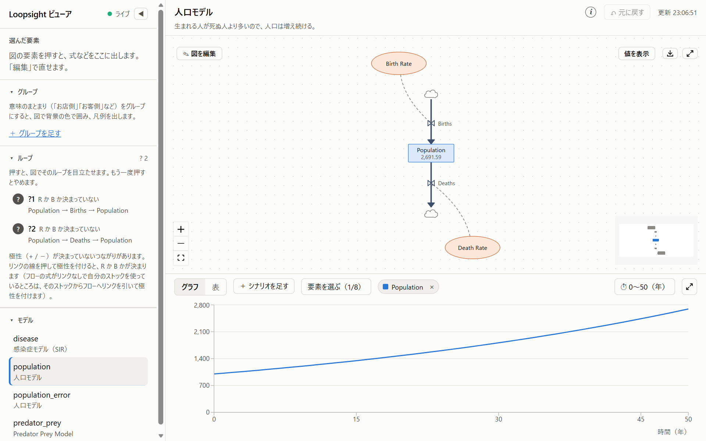

## 目次

- [起動のしかた](#起動のしかた)
- [画面の全体](#画面の全体)
- [図の見方](#図の見方)
- [グラフと表](#グラフと表)
- [要素の詳しい情報](#要素の詳しい情報)
- [要素を編集する](#要素を編集する)
- [編集モード](#編集モード)
- [図の要素を動かす](#図の要素を動かす)
- [元に戻す](#元に戻す)
- [AI と同時に変えたとき](#ai-と同時に変えたとき)
- [AI の変更がその場で反映される](#ai-の変更がその場で反映される)
- [エラーがあるとき](#エラーがあるとき)
- [暗い配色](#暗い配色)
- [困ったとき](#困ったとき)
- [このページのスクリーンショットを撮り直す](#このページのスクリーンショットを撮り直す)

## 起動のしかた

ターミナルでビューアを起動します。Node.js 22 以上が必要です（入れ方は [はじめての手順](getting-started.md)）。`--models-dir` には、MCP サーバーに渡したのと同じ作業フォルダを書きます。

macOS、Linux、WSL：

```bash
npx -y -p loopsight loopsight-viewer --models-dir ~/loopsight-models
```

Windows（PowerShell）：

```powershell
npx.cmd -y -p loopsight loopsight-viewer --models-dir $HOME\loopsight-models
```

`npm install -g loopsight` で入れたあとは、`loopsight-viewer --models-dir ...` だけで起動できます。リポジトリを clone して開発しているときは、`npm run build` のあと `npm run viewer` で起動します（[開発に参加する](../CONTRIBUTING.md)）。

次のように表示されたら、ブラウザで http://localhost:5180/ を開きます。

```
Loopsight ビューア: http://localhost:5180/
作業フォルダ: C:\Users\...\loopsight-models
```

止めるときは、起動したターミナルで Ctrl+C を押します。

### よくある使い方

1. ビューアを起動して、ブラウザで開いておく
2. Claude Code で、AI にモデルを作ったり変えたりするよう頼む（「人口モデルを作って」など）
3. AI がモデルを保存すると、画面がその場で変わる。図とグラフで中身を確かめる

ビューアと MCP サーバーは別々に動いていて、作業フォルダのファイルだけでつながっています。どちらを先に起動してもかまいません。

### 設定

| 設定 | 決め方 | 既定 |
|---|---|---|
| 作業フォルダ | `--models-dir <フォルダ>`、環境変数 `LOOPSIGHT_MODELS_DIR` の順 | 起動したフォルダの `models/` |
| ポート | `--port <番号>`、環境変数 `LOOPSIGHT_VIEWER_PORT` の順 | 5180 |

作業フォルダの決め方は MCP サーバーと同じです。MCP サーバーと違うフォルダを見ていると、AI の変更が画面に出ません。

macOS、Linux、WSL：

```bash
npx -y -p loopsight loopsight-viewer --models-dir ~/work/models --port 5181
```

Windows（PowerShell）：

```powershell
npx.cmd -y -p loopsight loopsight-viewer --models-dir D:\work\models --port 5181
```

`npm run viewer` で起動するときは、`npm run viewer -- --port 5181` のように `--` のあとに書きます。

ビューアは自分の PC の中（`127.0.0.1`）でだけ動きます。ほかの PC やスマートフォンからは開けません。

## 画面の全体

| 場所 | 内容 |
|---|---|
| 左上 | 「ライブ」の緑の点は、ファイルの変更を見張っている印です。灰色の「未接続」なら、ビューアが止まっています |
| 左の「選んだ要素」 | 図の要素を押すと、式などの詳しい情報が出ます。よく使うので、いちばん上にあります（[要素の詳しい情報](#要素の詳しい情報)） |
| 左の「ループ」 | モデルのフィードバックループの一覧です。押すと、図でそのループを目立たせます（[ループを目立たせる](#ループを目立たせる)） |
| 左の「問題」 | モデルにエラーや警告があるときだけ出ます（[エラーがあるとき](#エラーがあるとき)） |
| 左下の「モデル」 | 作業フォルダのモデルの一覧です。作業フォルダの中のフォルダと同じ形で出します（[モデルの一覧とフォルダ](#モデルの一覧とフォルダ)）。上の行がファイル名、下の行がモデルの名前です。押すとそのモデルを開きます。見出しを押すと一覧を閉じたり開いたりできます（閉じているあいだはモデルの数を出します）。開け閉めはブラウザが覚えています |
| 上の帯 | 2 行です。1 行目はモデルの名前と、「i」（座標のない要素があるときだけ。[配置](#配置)）、「元に戻す」、最後に読み込んだ時刻。2 行目はモデルの説明の最初の段落（最初の空行まで。段落の中の改行は空白にします）だけを、帯の幅いっぱいに出します。説明のないモデルでは 2 行目を出さず、帯は 1 行です。名前と説明が入りきらないときは「…」で省略します（カーソルを乗せると全部出ます。説明は全文が出ます） |
| 真ん中 | モデルの図です（[図の見方](#図の見方)）。左上の「✎ 図を編集」で[編集モード](#編集モード)を、右上の「値を表示」で[要素の値の表示](#図に値を出す)を切り替えます |
| 下 | 実行結果のグラフと表です（[グラフと表](#グラフと表)） |

左の欄は、左の欄の右上の「◀」でたためます。図とグラフを見ながら話し合うときなど、左の欄を使わないときに、図とグラフを横に広く使えます。

- たたむと、左端に「▶ 左の欄」の細い帯が残ります。帯を押すと開きます
- 図で要素や線を選んだり、シナリオの名前を押したりしても開きません（見せながら指すときにも押すため）。詳しい情報を見るときは、帯を押して開きます
- 「✎ 図を編集」をオンにしたときと、シナリオの吹き出しで「説明を直す」を押したときは、左の欄で作業するので自動で開きます
- 開いているかたたんでいるかはブラウザが覚えていて、ビューアを開き直したときも同じ状態から始まります。画面の幅で自動でたたんだり開いたりはしません
- 狭い画面（幅 760px 以下の、縦に並べる表示）ではたためず、いつも左の欄を出します。覚えている状態は、広い画面に戻ったときに使います

開いているモデルは、アドレスの `#` のあとに出ます（例：`http://localhost:5180/#population`。フォルダの中のモデルは `#ブルックスの法則/brooks_law`）。このアドレスをブックマークしておくと、そのモデルを直接開けます。何も指定しないと、いちばん最近変わったモデルを開きます。

### モデルの一覧とフォルダ

関係のあるモデルは、作業フォルダの中のフォルダ（フォルダの中のフォルダも）にまとめて置けます。左下の「モデル」の一覧は、作業フォルダの中の実際のフォルダと同じ形で出します。エクスプローラーで見たときと同じく、どの段もフォルダが先、そのあとにモデルが名前順に並びます。

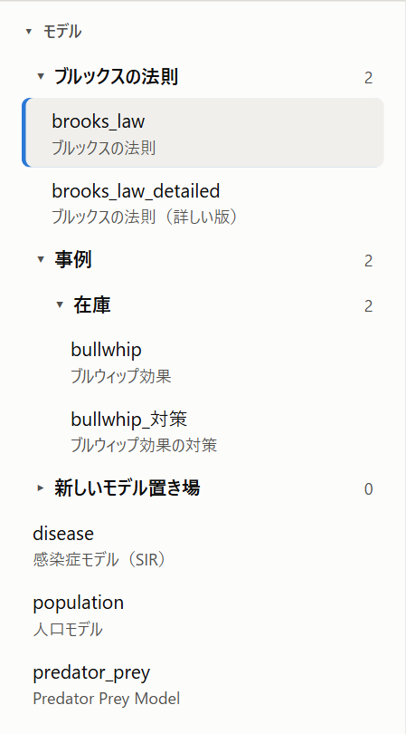

- **フォルダ：** 押すと開いたり閉じたりします。右の数は、中にあるモデルの数です（フォルダの中のフォルダも数えます）。開いているかどうかはブラウザが覚えています。開いているモデルが入っているフォルダは、自動で開きます
- **出すもの：** モデルと、モデルが入っているフォルダと、空のフォルダです。空のフォルダは「空のフォルダ」と出ます。モデル以外のファイル（実際のデータの `.data.csv` など）や、モデルでないファイルしかないフォルダ（`run_simulation` の CSV の置き場の `output/` など）、先頭が `.` のフォルダは出しません
- **モデルの名前：** フォルダの中のモデルの名前は、作業フォルダからの相対パスです（例：`ブルックスの法則/brooks_law`）。AI に頼むときもこの名前で伝わります。実際のデータは、モデルと同じフォルダに置きます
- **フォルダを作る・動かす：** エクスプローラーで直接作ったり動かしたりできます。AI に「ブルックスの法則のモデルを 1 つのフォルダにまとめて」などと頼んでもかまいません（AI は MCP の `move_model`、`create_folder`、`move_folder`、`remove_folder` を使い、実際のデータもいっしょに動かします）。どちらでも、一覧はその場で変わります。画面からは動かせません
- **開いているモデルが動かされたり消されたりしたとき：** 図とグラフは出したまま、上に赤い帯で「ファイルが見つかりません」と知らせ、左の欄とモデルの一覧を開きます。一覧から選び直してください（ファイルが元の場所に戻れば、知らせは消えます）。なくなったモデルを画面で直そうとしても保存しません（動かした先と元の場所の両方にモデルができないように）

## 図の見方

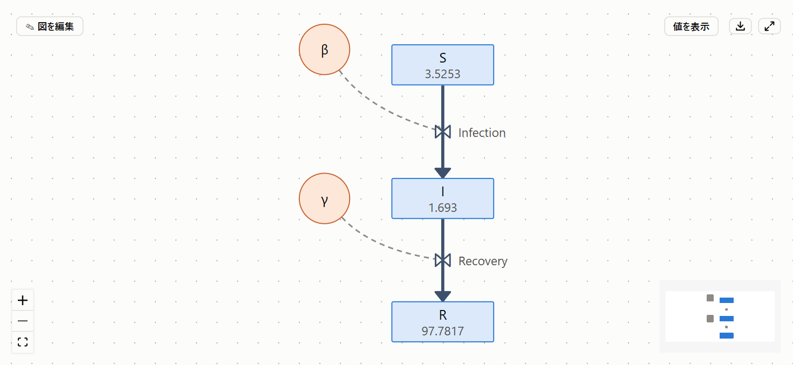

| 形 | 要素 | 説明 |
|---|---|---|
| 青い四角 | ストック | たまっている量（人口、在庫など）。下の小さい数字は、実行の最後の値です（「値を表示」がオンのときは出しません） |
| 橙の楕円 | 変数 | 決まった値や、式で計算する値 |
| 緑の角が丸い四角 | コンバーター | 表で入力を出力に変える要素 |
| 太い線と ⋈ | フロー | ストックに出入りする流れ。⋈（弁）の横にフローの名前が出ます。矢印の向きに流れます |
| 雲 | モデルの外 | フローの出元や行き先がモデルの外のとき |
| 点線の矢印 | リンク | 「この要素の値を、矢印の先の式で使う」というつながり。`+` `-` は極性です（[リンクの極性](#リンクの極性)） |
| 線の途中の ‖ | 遅れの印 | 時間がたってから効くつながり（[遅れの印](#遅れの印)） |
| 点線の枠の文字 | 注釈 | 図の説明のための文字（[注釈](#注釈)）。シミュレーションの要素ではありません |

箱の幅は名前の長さで決まります。とても長い名前は、言葉の切れ目で 2 行に分けます（2 行まで）。モデルに大きさ（`display.size`）があれば、その大きさで描きます（名前が入りきらないときは、箱の中で折り返します）。`view_diagram` で重なりを確かめるときも、同じ大きさを使います。

### 図の操作

開いたときは、図が欄に入るように合わせます。ただし名前が読める大きさより小さくはしません。それで全体が入らないときは、ストックが入るように合わせます。ほかの要素はドラッグかミニマップで動かして見ます。

- **見る場所を動かす：** 図の何もないところをドラッグします
- **拡大・縮小：** マウスのホイールか、左下の `+` `−` を押します
- **全体を表示：** 左下の `⛶` を押すと、図全体が入るように戻ります。大きな図は名前が読める大きさまでしか縮めないので、はみ出したところはドラッグかミニマップで見ます
- **ミニマップ：** 右下の小さな図が全体です。四角が今見ているところです。ミニマップの上でドラッグすると見る場所が動き、ホイールで拡大・縮小します
- **要素を選ぶ：** 要素を押すと青い枠が付き、左に詳しい情報が出ます。図では、その要素に出入りする線とつながる相手だけをふつうに出し、ほかは薄くします（フローなら弁、両端、弁につながるリンクとその相手。ストックなら出入りするフローとその先の端、リンクの相手。変数ならリンクの相手で、相手がフローなら弁だけ）。何もないところを押すと選ぶのをやめ、元に戻ります
- **線を選ぶ：** リンク（点線の矢印）を押すと線が青くなり、左に何から何へのリンクかが出ます。図では、その線と両端の要素だけをふつうに出します。フローの線を押すと、そのフローを選びます。線の上からドラッグしても見る場所は動かないので、何もないところからドラッグします
- **要素を動かす：** [編集モード](#編集モード)をオンにして、要素をドラッグします。離すと位置を保存します（[図の要素を動かす](#図の要素を動かす)）。オフのときは、要素をドラッグしても要素は動かず、図全体の見る場所が動きます

### 配置

モデルに座標（図の上の位置）があれば、そのとおりに描きます。

座標のない要素が 1 つでもあると、その要素だけを簡易レイアウトで仮に並べます（AI の `layout_model` と同じ並べ方です）。上の帯に「i」のアイコンが出ます。押すと（カーソルを乗せても）、仮に並べていることと、保存のしかたの説明が出ます。仮の並びはファイルに保存しませんが、編集モードで要素を 1 つでも動かすと、そのとき見えている配置をまとめて保存します。

配置を整えるときは、次の 2 つの方法があります。

- **自分で動かす：** 編集モードで要素をドラッグします（[図の要素を動かす](#図の要素を動かす)）
- **AI に頼む：** 「図の配置を整えて」「線が交差しないように並べ直して」などと頼みます。AI は `view_diagram` で、このビューアと同じ描き方の図の画像と、箱の重なり・線が要素や名前の上を通るところ・線の交差・1 か所に集まる線の一覧を見ながら、位置を直します。直すたびに、開いているビューアにもその場で出ます

### 注釈

要素の補足や「この図の読み方」のような説明は、図の中に注釈として書き込めます。説明する箱のすぐ近くに置けるので、図を資料に貼っても、どの箱の話かが離れません。

- **見た目：** 塗りのない点線の枠に、左寄せの文字で出します。要素（色の付いた箱や楕円）と見分けが付くようにしています
- **文字：** 複数行にできます。決まった幅（200。AI に頼めば 60〜800 に変えられます）で折り返し、改行したところでも行を分けます
- **要素ではない：** どこにもつながらず、式から参照できません。ループの探索、検証、グラフの要素の一覧にも出ません。モデルの `annotations` に、ループサイト独自の項目として保存します（Insight Maker は知らない項目があると読み込めないことがあります。[モデルのファイルの形式](reference/model-format.md#loopsight-が足した項目)）
- **出るところ：** この画面の図と、AI が `view_diagram` で見る図の両方に出ます（図の部品は共通です）。ループを目立たせているときも、注釈は薄くしません。図の左上はループの名前の札で隠れることがあるので、注釈は左上の角を避けて置きます
- **画面で置く・直す・消す：** 編集モードの「＋注釈」で置き、ドラッグで動かし、「削除」か Delete キーで消します（[注釈を置く](#注釈を置く)）。文字は、注釈を押して選び、左の「編集」で直します
- **AI に頼む：** 「人口の箱の近くに、出生率が上がると早く増えると注釈を書いて」などと頼みます。AI は MCP の `set_annotations` で置き・直し・消し、`view_diagram` で注釈と要素や線の重なりを確かめます。`layout_model` は注釈を動かしません。箱（ストックや変数など）は注釈を避けて置きますが、雲やフローの線・名前は注釈に重なることがあるので、AI は `view_diagram` で確かめて直します
- **凡例は作らない：** 色の説明（凡例）は、注釈では作りません

### ループを目立たせる

会議などで原因を説明するときは、フィードバックループ（つながりをたどって元の要素に戻る輪）を目立たせます。ループの要素と線だけをふつうに出してほかを薄くし、ループの線を太くします（強めるループ R は赤、釣り合わせるループ B は青、R か B か決まっていなければ灰色）。図の左上に、ループの名前と R / B を出します。

- **一覧：** 左の欄の「ループ」に、モデルのループを短い順に並べます。ループごとに、名前（R1、B2 など。R か B か決まっていなければ ?1 など）、強めるループか釣り合わせるループか、通る要素をつながる順に出します。遅れの印（‖）のあるつながりを通るループには「‖ 遅れあり」と出します。見出しの横には、R・B・決まっていないループの数を出します。中身は AI の `find_loops` と同じです
- **目立たせる：** 一覧のループを押すと、図でそのループを目立たせます。もう一度押すか、ほかのループを押すとやめます（ほかのループを押したときは、そちらを目立たせます）。目立たせている間も、要素や線を選ぶ、拡大縮小する、図を編集することができます。ループの名前の札は、図の左上の「図を編集」の下に出ます。札の右上の ✕ を押してもやめられます（左の欄をたたんでいるときに使います）
- **書き出す：** 目立たせている間に図の右上の書き出すボタンを押すと、目立たせた図（札も入ります）を書き出します。AI の `export_diagram` に、`find_loops` の `elements` と `name` を `loop` で渡したときと同じ図です。保存先とファイル名は、ふつうの書き出しと同じです（[図を画像に書き出す](#図を画像に書き出す資料に貼る用)）
- **モデルが変わったとき：** AI の変更も含め、モデルが変わるたびに一覧を出し直します。[リンクの極性](#リンクの極性)を変えると、R / B と名前もその場で変わります。目立たせていたループは、同じ要素を回るループがあれば目立たせたままにし、なくなったら（リンクを消したなど）やめます
- **R か B か決まっていないループ：** 極性が決まっていないつながりを通るループです。リンクの線を押して極性を付けると決まります
- **ループが多いとき：** AI の `find_loops` と同じく、短いものから 200 個までを出し、そのことを一覧の下に書きます

AI は `find_loops` でループを探し、`view_diagram` の `loop` で、ループを目立たせた図の画像を見られます。

### 大事な要素を強調する

説明のときに「ここを見てほしい」という要素（問題になっている在庫など）は、強調の印を付けると、図で大きく描きます。箱と名前の文字を 1.4 倍にし、枠を太くします（名前は太字になります）。段階は「ふつう」と「強調」の 2 つだけです。

- **付け外し：** 要素を選び、左の詳しい情報の下にある「図で強調する（大きく描く）」をオンにします。押すとすぐ保存します。オフにすると、ふつうに戻ります。強調できるのはストック、変数、コンバーターです（フローとリンクはできません）
- **AI に頼む：** 「在庫を強調して」と頼みます。AI は `upsert_elements` で、要素の `display` に `emphasis: true` を入れます（`false` でふつうに戻します）
- **位置：** 付け外ししても、箱の真ん中の位置は変わりません。大きくなって隣の要素と重なったら、[編集モード](#編集モード)で動かすか、AI に配置を直してもらいます。AI の `layout_model` と `view_diagram` の重なりの確認は、大きくなった箱の大きさを使います
- **大きさを決めた要素：** モデルに大きさ（`display.size`）がある要素は、その大きさを基準に 1.4 倍にします
- **どこに出るか：** 作業画面の図と、AI が `view_diagram` で見る図の両方に同じように出ます（図の部品は共通です）。ループを目立たせているときは、ループの外の強調した要素も、ほかと同じように薄くします
- **シミュレーション：** 図の見た目だけの印なので、計算の結果は変わりません。印はモデルのファイル（ModelJSON）の `display.emphasis` に、ループサイト独自の項目として保存します。Insight Maker は知らない項目があると読み込めないことがあるので、Insight Maker にファイルを読み込ませるときは、強調を外してから渡します（[モデルのファイルの形式](reference/model-format.md#loopsight-が足した項目)）

### リンクの極性

リンクの終わり近くの `+` `-` は極性です。`+` は「元が増えると先も増える」、`-` は「元が増えると先は減る」つながりです。ループの `-` の数が偶数なら強めるループ（R）、奇数なら釣り合わせるループ（B）になります。極性が決まっていないリンクを通るループは、R か B か決まりません。

- **付け方：** リンクの線を押して選びます。左の欄の「極性」で「+」「−」「なし（決めない）」のどれかを押すと、すぐ保存します。「なし」を選ぶと極性を外します。[編集モード](#編集モード)に関係なく、いつでも使えます。「元に戻す」でも戻せます
- **AI に頼む：** 「人口から出生へのリンクを + にして」などと頼みます。AI は `upsert_elements` の LINK の `behavior.polarity`（`POSITIVE` が +、`NEGATIVE` が -）で付け外しします。画面で付けた極性も同じ項目に保存するので、AI の `get_model` でも見えます
- **ループの説明：** 極性を変えると、AI の `find_loops` や `view_diagram` の `loop` で見る R / B も変わります
- **フローは対象外：** フロー（ストックに出入りする線）は、行き先のストックを増やし（+）、出元のストックを減らす（-）と決まっているので、極性は付けません

### 遅れの印

発注してから届くまで、採用してから戦力になるまで、のように「時間がたってから効く」つながりには、線の途中に二重線（‖）の印を付けられます。SD の図のふつうの書き方です。リンクは曲線の真ん中に、フローは弁から行き先までの線の真ん中に描きます。極性（`+` `-`）は線の終わり近くに出るので、重なりません。

- **付け方：** リンクなら線を押して選び、フローなら弁か名前を押して選びます。左の欄の「遅れの印（‖）を付ける」にチェックを入れると、すぐ保存します。外すときはチェックを外します。[編集モード](#編集モード)に関係なく、いつでも使えます。「元に戻す」でも戻せます
- **AI に頼む：** 「発注から入荷までのリンクに遅れの印を付けて」などと頼みます。AI は `upsert_elements` の `display.delay` で付け外しします
- **印は見た目だけ：** シミュレーションの結果は変わりません。実際の遅れは、式の `Delay` や `Smooth` などで表します。AI の `view_diagram` は、式で遅れて効くのに印のないリンクを知らせます（自動では付けません）
- **どこに出るか：** 作業画面の図と、AI の `view_diagram` の画像の両方に出ます（図の部品は共通です）。ループを目立たせた図では、ループの線と同じ色で太く出します
- **ループの説明：** AI の `find_loops` は、遅れの印のあるつながりを通るループに、そのつながり（`delays`）を挙げます。遅れのある釣り合わせるループ（B）は、行き過ぎて振れやすくなります

### グループで囲む

要素が多いモデルでは、「お店側の要素」「お客側の要素」のような意味のまとまりを「グループ」にできます。図では、グループに属する要素をまとめて薄い色の長方形で囲み（要素や線の後ろに描きます）、囲みの左上にグループの名前を出します。図の下の真ん中には、グループの色と名前の一覧（凡例）を出します。グループが 1 つもなければ、凡例は出しません。

- **囲みの位置と大きさ：** 属する要素の位置から自動で決まります。手で形を描くことはありません。要素を動かすと、囲みも付いてきます
- **色：** 黄・緑・青緑・紫・桃・茶・灰の 7 色から選びます。ループの R（赤）・B（青）やシナリオの色と紛れないよう、薄い色にしてあります。明るい配色・暗い配色のどちらでも読めます
- **1 つの要素が属するグループは 1 つまで** です。ほかのグループに属する要素を入れると、そちらから移ります
- **ループを目立たせているときや、要素を選んでいるとき** は、囲みもほかの要素と同じく薄くします
- **AI が見る図：** `view_diagram` の図にも、同じ囲みと凡例が出ます（図の部品はビューアと共通です）
- **名前を変えた・消した要素：** グループの中身も合わせて直ります

グループは、左の欄の「グループ」で直せます。

- **名前と色：** 名前の欄を書き換えて Enter で保存します（Esc でやめます）。色は左の選択で選びます。右の数字は属する要素の数で、カーソルを乗せると要素の名前が出ます
- **要素を入れる・外す：** 図で要素を選ぶと、「「要素の名前」のグループ」の選択が出ます。グループを選ぶとそのグループに入れ、「なし」を選ぶと外します
- **足す・消す：** 「＋ グループを足す」で新しいグループを足します。要素を選んでいれば、その要素を入れます。✕ でグループを消します（要素は消えません）。どれも「元に戻す」（Ctrl+Z）で戻せます

AI にも頼めます（MCP の `set_groups`）。たとえば「在庫と仕入れをお店側、注文と注文残をお客側のグループにして」と頼みます。AI は `layout_model` で、同じグループの要素が近くに集まるように並べ直せます。`view_diagram` は、囲みどうしが重なっているところや、グループに属さない要素が囲みの中に入っているところを一覧（`group_issues`）で返すので、AI はそれを見ながら配置を直します。

グループは、ループサイト独自の項目（ModelJSON の `groups`）としてモデルに保存します。シミュレーションの結果には影響しません。Insight Maker は知らない項目があると読み込めないことがあります（[モデルのファイルの形式](reference/model-format.md#loopsight-が足した項目)）。

### 図に値を出す

図の右上の「値を表示」をオンにすると、ストック・フロー・変数に、その時点の値と、シミュレーションの最初の時点からの変化を小さく出します。どこで、どれだけ大きく変わったかが、グラフで 1 本ずつ見比べなくても図の上でわかります。SD を知らない人に図で説明するときや、振る舞いを分析するときに使います。モデルを考えている間は邪魔になるので、ふだんはオフにしておきます（オンかオフかはブラウザが覚えています）。

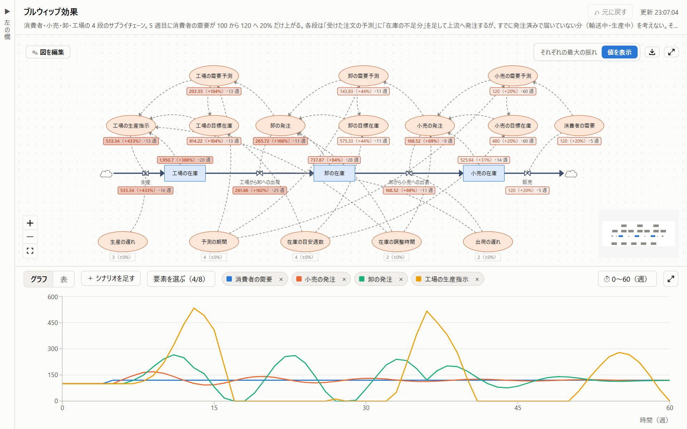

- **出し方：** `120（+20%）` のように、値と、最初の値からの変化を出します。値はグラフのツールチップと同じ丸め方です。最初の値が 0 のときは、割合の代わりに差（`+12`）を出します
- **色：** 増えたら橙、減ったら青で出し、変化が大きいほど地の色を濃く、字を太くします。変わらない要素（決まった値の変数など）は灰色で `±0%` と出し、目立たせません
- **図の合わせ方：** オンにした・オフにしたときは、図を欄に合わせ直します。オンの間は、右上の道具の下に要素が隠れないよう、上を少し空けて合わせます
- **場所：** 変数は箱の下、ストックは箱の上（下に並ぶフローの名前と重ならないように）、フローは弁の横の名前の下に出します。オンの間は、ストックの下の「最後の値」は出しません。シナリオの札（[図のどこを変えたかを見る](#図のどこを変えたかを見る)）が付いたストックは、札が上に出るので、値は下に出します
- **どの時点の値か：** グラフにカーソルを乗せていないときは、要素ごとに最初の値から一番大きく離れた時点の値を出し、その時点を添えます（例：`533.34（+433%）・13 週`）。グラフにカーソルを乗せている間は、その時刻の値に変わります。カーソルを左右に動かすと、振れが伝わっていく様子が見えます。外すと、最大の振れに戻ります。いまどちらを出しているかは、「値を表示」の左に「それぞれの最大の振れ」「9 週の値」のように出ます

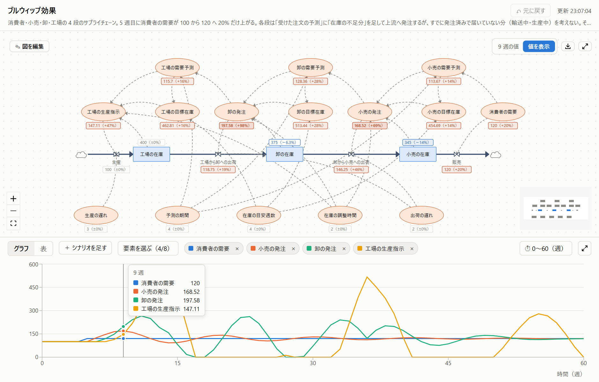

- **シナリオの値：** シナリオがあるときは、「値を表示」の左に「元のモデル」とシナリオの名前を並べた選択が出ます。選んだシナリオの値を出し、変化はそのシナリオの中の最初の時点と比べます（シナリオどうしや元のモデルとの比較は、グラフの上の表で見ます）。選んだシナリオが実行できなくなったり、AI などに消されたりしたときは、「元のモデル」に戻ります
- **AI が変えたとき：** AI がモデルを変えて実行し直すと、新しい結果で出し直します

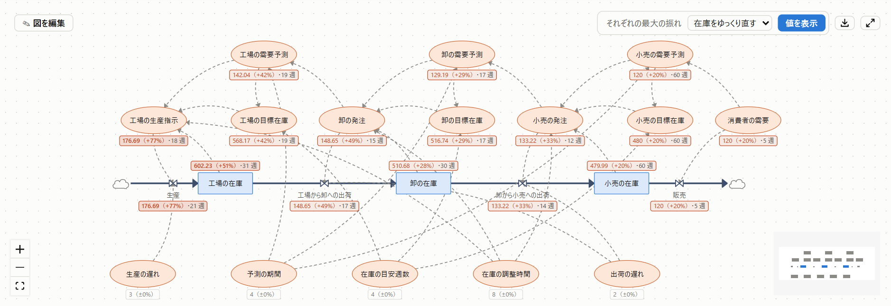

ブルウィップ効果のモデル（消費者・小売・卸・工場の 4 段のサプライチェーン）では、最大の振れが「消費者の需要」+20% →「小売の発注」+69% →「卸の発注」+166% →「工場の生産指示」+433% と、上流に行くほど大きくなるのが図だけで読み取れます。

#### 選んだ要素の式に値を入れて見る

「値を表示」がオンのときに図で要素を選ぶと、その要素の式に、その時点の値を入れたものを箱の横に出します。どこで大きくなったかだけでなく、なぜそこで大きくなったかを、式を 1 つずつ開かなくても読めます。

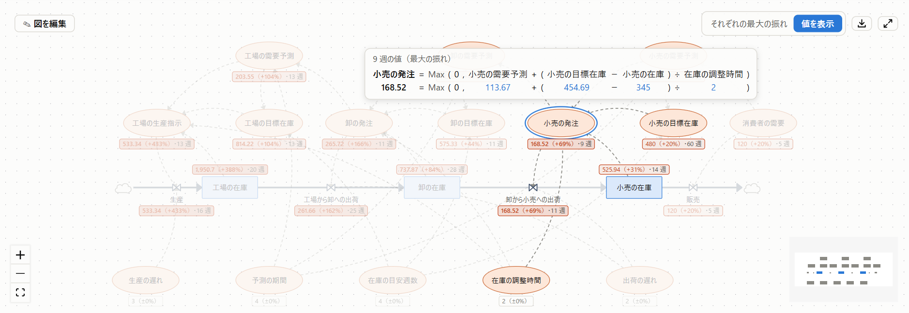

- **出し方：** 上の行は式（`[名前]` の括弧を外して名前だけにし、`*` `/` `-` は `×` `÷` `−` にします）、下の行は同じ並びで、参照しているところに値を入れたものです。左辺はその要素の値です。値は図の値と同じ丸め方です。上の例では、「小売の目標在庫 454.69 − 小売の在庫 345」の不足を「在庫の調整時間 2」週で埋めようとするので、需要予測の 113.67 に大きく上乗せされ、発注が 168.52 になっているのが読めます
- **どの時点の値か：** 図の値と同じです。グラフにカーソルを乗せていればその時刻、乗せていなければ選んだ要素の最大の振れの時点の値を出します。いつの値かは式の上に出ます（「9 週の値（最大の振れ）」など）。シナリオを選んでいれば、そのシナリオの値を入れます
- **ストック：** 式の代わりに、出入りするフローの値で「入る量 − 出る量」を出します（左辺は「〇〇の増え方」）。出入りするフローがないときは、そう出します

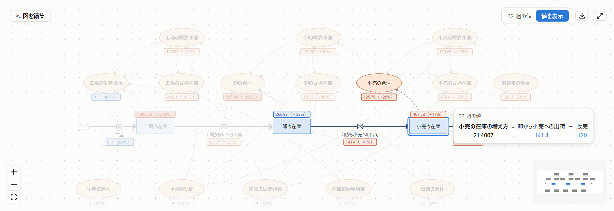

- **関数を含む式：** `Max` や `IfThenElse` などの関数は、そのまま出します。`Delay` や `Smooth` のような時間をまたぐ関数に渡す値（1 つ目の引数）は、いまの値ではなく過去の値を使うので、値を入れずに名前のまま薄く出します
- **長い式：** 式が長いとき（名前の長い参照が多く、そろえると箱に収まらないときを含みます）や、複数の行に分かれている・コメントを含むときは、下の行をそろえず、式の下に参照ごとの値の一覧（`小売の需要予測 = 113.67` …）を出します

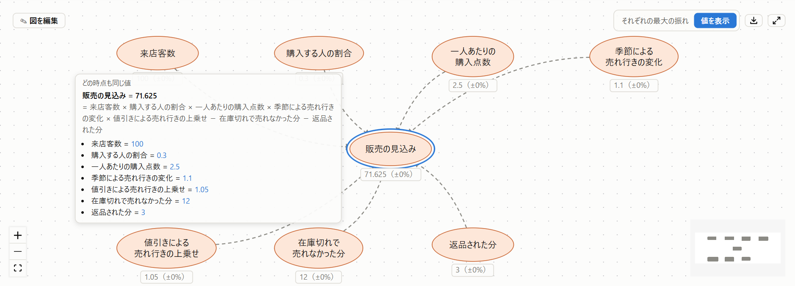

- **ストックの最大の振れ：** ストックの最大の振れの時点は、入る量と出る量がほぼ釣り合っていて、増え方が 0 に近くなります。そのときは「グラフにカーソルを乗せると、その時点の出入りが見られます」と添えます
- **決まった値の変数：** 式がないので、`在庫の調整時間 = 2` のように値だけを出します
- **場所：** 選んだ箱の右・左・上・下のうち、ほかの箱に重なりにくく、図の欄からはみ出しにくい側に出します。図を動かしたり拡大したりしてもついていきます。選ぶのをやめる（何もないところを押す）か、「値を表示」をオフにすると消えます。出すのは選んだ要素の 1 つだけです

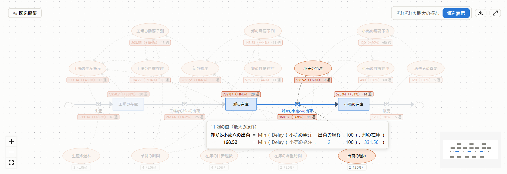

### 図を画像に書き出す（資料に貼る用）

図の右上の書き出すボタン（下向きの矢印。「値を表示」と広げるボタンのあいだ）を押すと、図だけを画像にして、作業フォルダの `exports/<モデル名>/`（フォルダの中のモデルは `exports/<フォルダ>/<名前>/`）に保存します。保存したファイルの場所は、上の帯の知らせに出ます。

```
exports/<モデル名>/
  diagram.svg   … 拡大してもぼやけない画像。PDF やスライド（PowerPoint など）に貼る
  diagram.png   … 2 倍の解像度の画像。SVG を貼れないアプリ向け
```

もう一度押すと、同じ名前のファイルを置き換えます。残しておきたいときは、ファイルの名前を変えておきます。

- **入るもの：** いま見ている表示のままです。「値を表示」の値、シナリオの札も入ります。強調した要素、遅れの印、グループの囲みと凡例（下の真ん中）、注釈など、図に描いてあるものはそのまま入ります。[ループを目立たせている](#ループを目立たせる)ときは、ループのほかを薄くした表示と、ループの名前の札も入ります。素の図だけがほしいときは、「値を表示」をオフにしてから押します
- **入らないもの：** 全体図、ズームのボタン、背景の点、図の右上と左上の道具、式の箱、選んでいる要素の枠と、要素や線を選んだことでほかを薄くした表示、ループの札の ✕、編集モードの色や線を引く口は入れません
- **大きさ：** ズームや見ている場所にかかわらず、図全体が収まるように切り取ります。大きさは、ズームが 1 倍のときの図の大きさです
- **配色：** 背景は白で、暗い配色で見ていても、いつも明るい配色で書き出します
- **文字：** SVG の文字は画像にせず文字のまま入れるので、拡大しても読めます。開くパソコンに画面と同じフォントがなくても崩れにくいよう、文字の幅は画面と同じにそろえ、日本語のフォント（游ゴシック、メイリオ、ヒラギノ角ゴ、Noto Sans JP）を順に使います。フォントの形は、開くパソコンにあるものに変わることがあります

AI に頼むときは、「図を資料用に書き出して」などと言います。AI は MCP の `export_diagram` で、同じ描き方で同じ場所に書き出します。`loop` を渡すと、ループを目立たせた図（ループの名前と R / B の札が図の上に付く）も書き出せます。

## グラフと表

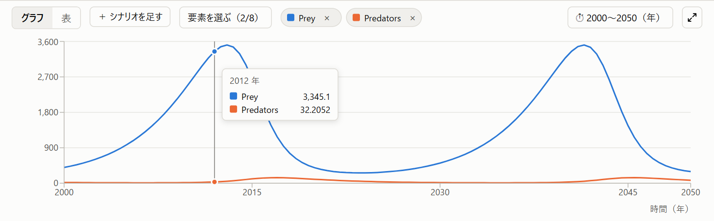

下の欄には、モデルを実行した結果を出します。横軸は時間で、単位はモデルの設定（年、週など）です。何時から何時までを、どの刻み幅で計算するかは、上の帯の右の期間のボタン（`⏱ 0〜100（年）` のような形）で見て直せます（[シミュレーションの設定を直す](#シミュレーションの設定を直す)）。

図と下の欄の境界線を上下にドラッグすると、下の欄の高さを変えられます（図のズームや位置はそのまま）。高さはブラウザが覚えています。狭い画面（幅 760px 以下）では縦に並ぶだけで、境界線は出ません。

図か下の欄の片方だけを大きく見たいときは、右上の広げるボタン（外向きの矢印）を押します（図は「値を表示」の右、下の欄は上の帯の右端）。押した方が右側いっぱいに広がり、もう片方は「図 ▼」「グラフ・表 ▲」のような見出しだけの細い帯になります。帯か、同じボタン（広げている間は内向きの矢印）を押すと、上下に分けた形に戻ります。戻したときの高さは、境界線で決めていた高さのままです。ノート PC のように縦が狭い画面で、図とグラフのどちらも窮屈なときに使います。

- 図を広げたり戻したりしても、図のズームや位置はそのままです。全体を見直すときは、左下の `⛶` を押します
- 帯にしている間も、要素を選ぶ、AI の変更がその場で反映されるなどは、ふだんどおりに動きます。帯にした方が勝手に開くことはありません
- どちらを広げているか（広げていないか）は、ブラウザが覚えています。ページを開き直しても、同じ形で開きます

- **最初に出る要素：** モデルにグラフの設定があれば、その要素を出します。なければストックを出します
- **凡例：** 上の帯には、グラフに出している要素だけを、線と同じ色で並べます。名前の横の × を押すと、その要素をグラフから外します。帯は 1 行で、入りきらないときは名前を「…」で省略します（カーソルを乗せると全部出ます）。それでも入りきらないときは、帯を横にスクロールして見ます
- **要素を選ぶ：** 「要素を選ぶ（2/8）」を押すと一覧が開きます。括弧の中は、出している本数と出せる本数です。一覧はストック、フロー、変数ごとにまとめてあり、チェックを付けるとグラフに出ます。上の欄に名前の一部を入れると絞り込めます（空白で区切ると、すべての言葉を含む名前に絞ります）。Esc か、一覧の外を押すと閉じます
- **同時に出せるのは 8 本まで：** 8 本出しているときは、一覧のほかの要素は選べなくなります。1 本外すと選べるようになります
- **色は要素ごとに決まる：** ほかの要素を出し入れしても、出ている線の色は変わりません
- **値を読む：** グラフの上にカーソルを乗せると、その時刻の値が出ます

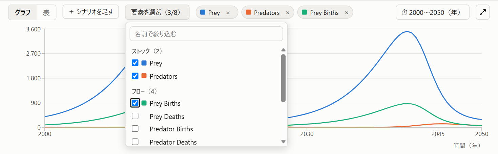

### 表

「表」を押すと、同じ要素を数字の表で見られます。正確な値を確かめたいときに使います。列は、上で選んだ要素です。

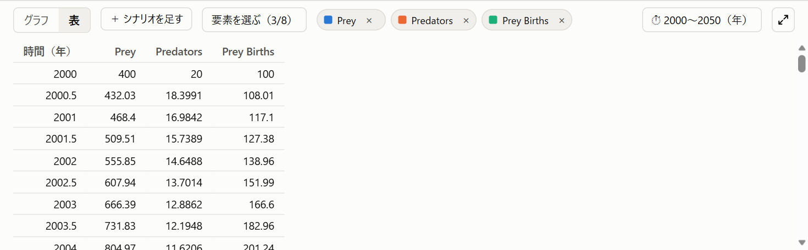

### シナリオを比べる

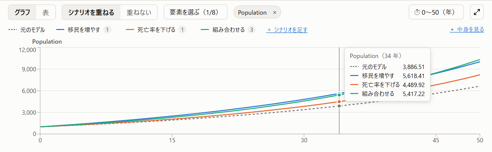

モデルにシナリオが保存されていると、グラフは要素ごとに分かれ、それぞれに「元のモデル」とシナリオを重ねて出します。シナリオは画面で足せます（[シナリオを直す](#シナリオを直す)）。AI に頼んでも保存できます（MCP の `set_scenarios`）。たとえば「出生率を 4% に上げるシナリオと、移民を受け入れるシナリオを保存して」と頼みます。

- **元のモデル：** モデルの値を何も変えずに実行した結果です。灰色の点線で出します
- **シナリオの色：** シナリオごとに色が決まります。グラフの上の帯がシナリオの凡例です。シナリオの名前の横の小さな数字は、そのシナリオで変えた値の数です。カーソルを乗せると、シナリオの説明と、変える値が出ます。同時に重ねられるシナリオは 8 つまでです。9 つ目からはグラフに出さず、そのことを凡例の下に出します
- **要素を選ぶ：** 「要素を選ぶ」で選んだ要素ごとに、小さなグラフが並びます。入りきらないときは、グラフの欄を縦にスクロールします
- **値を読む：** グラフの上にカーソルを乗せると、その時刻の、どのシナリオの値も出ます
- **表：** 列は「要素 × シナリオ」です。シナリオの凡例の帯も、グラフのときと同じように出ます
- **重ねない：** 「重ねない」を押すと、シナリオを保存する前と同じ、元のモデルだけのグラフに戻ります
- **その場で変わる：** AI がシナリオの値を変えたり、シナリオを足したり消したりすると、グラフがその場で変わります。実行できないシナリオがあると、グラフの上にその理由を出します

#### シナリオの中身を表で比べる

帯の右端の「▸ 中身を見る」を押すと、凡例が開いて、シナリオごとに「何を、どれだけ変えたか」と「結果」を並べた表になります。シナリオが 2 つ以上あるときや、1 つのシナリオで値をいくつも変えているときに、シナリオの違いが一目でわかります。

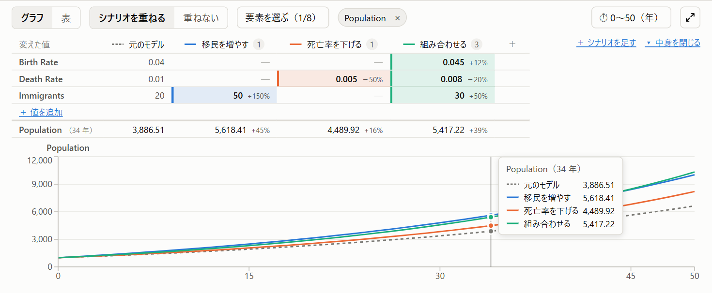

- **列：** 凡例がそのまま列の見出しになります。「元のモデル」と、グラフに重ねているシナリオです（並びと線の色は凡例と同じ）。実行できなかったシナリオと、色が足りずに出していないシナリオは、列に入れません
- **変えた値の行：** どれかのシナリオで変えた要素と、表の「＋ 値を追加」で足した要素を、モデルの並び順で出します
  - 「元のモデル」の列は、いまのモデルの値です。ストックは初期値（行の見出しに「初期値」と出ます）、変数とフローは式です
  - シナリオの列は、そのシナリオで変えていればシナリオの値を、シナリオの色を付けて出します。変えていなければ「—」を薄く出します
  - 両方が数なら、「元のモデル」からの変化を添えます（例：`+50%`、`−25%`）。0 からの変化など率にできないときは差（例：`+2`）を添えます。式のときは添えません
- **結果の行：** 最後の行は、グラフで選んでいる要素の、最後の時点の値です。シナリオの列には「元のモデル」からの変化を添えます。グラフにカーソルを乗せている間は、その時点の値に変わります（行の見出しに、要素の名前と時点を出します。例：`Population（34 年）`）。要素を複数選んでいるときは、要素ごとに 1 行です
- **行が多いとき：** 変えた値が 6 行を超えると、超えたぶんを畳んで「ほか N 件」と出します。押すと開きます
- **名前を変える・消す：** 列の見出しのシナリオの名前を押すと、小さな吹き出しが出ます。名前を変える、シナリオを消す、説明を直す、ができます（[シナリオを直す](#シナリオを直す)）
- **表で値を直す：** シナリオの列のマス（「—」も）を押すと、その場で値を書き換えられます。Enter で保存、Esc でやめます。マスにカーソルを乗せると出る × か、Delete で、そのシナリオではその値を変えない（「—」に戻す）ことにします
- **表でシナリオを足す・複製する：** 列の見出しの右端の「＋」か、帯の右の「＋ シナリオを足す」で、値を変えないシナリオを足します。シナリオの見出しの「複製」で、同じ値のシナリオを作ります。どちらも名前を入れて Enter で保存します。名前が使えないとき（ほかのシナリオと同じ名前など）は、名前の欄の下に理由を出し、保存しません
- **行を足す・消す：** 変えた値の行の下の「＋ 値を追加」で、まだどのシナリオでも変えていない値を選ぶと、全部「—」の行ができ、そのマスから値を入れられます。足した行は、消すまで残します（再読み込みすると消えます）。行の名前にカーソルを乗せると出る × で、すべてのシナリオでその値を変えないことにして、行を消します。確認は出しませんが、Ctrl+Z を 1 回押すと全部戻ります
- **幅が足りないとき：** 表を横にスクロールします。グラフの幅は変わりません
- **閉じる：** 「▾ 中身を閉じる」で元の凡例に戻ります。開いているか閉じているかはブラウザが覚えていて、次に開いたときも同じです

#### 図のどこを変えたかを見る

シナリオの凡例（開いているときは表の列の見出し）にカーソルを乗せている間は、図の中の「そのシナリオで変えた要素」に小さな札を付けます。シナリオが図のどこに手を入れたのかが、図の上でわかります。

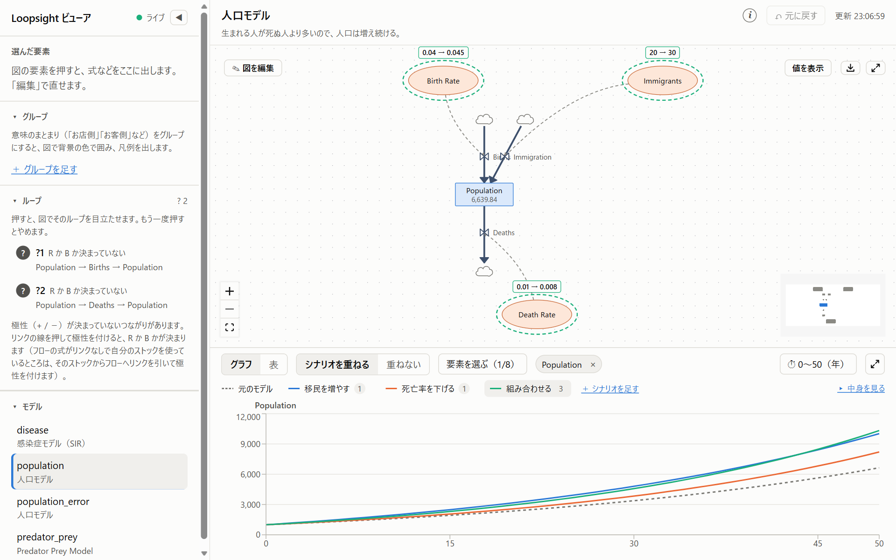

- **札の中身：** 「いまの値 → シナリオの値」です（例：`20 → 50`）。ストックは初期値で、札に「初期値」と添えます。長い式は省略します。要素にカーソルを乗せると、全文が出ます
- **色：** 札と要素の点線の枠は、そのシナリオの線の色です。選んだ要素の枠や、ループを目立たせたときの線とは別に、外側に点線で描くので、重なっても見分けられます
- **説明を直している間：** 左の欄でシナリオの説明を直している間も、そのシナリオの札を付けます。札に出すのは保存してある値で、表のマスに入れている途中の値ではありません。実行できなかったシナリオや、色が足りずにグラフに出していないシナリオは、灰色で付けます
- **出さないとき：** 「元のモデル」に乗せたときは何も出しません。普段（シナリオに注目していないとき）も出しません
- **図の操作：** 札が付いている間も、要素を選ぶ・拡大縮小はいつもどおりできます（編集モードなら動かすこともできます）。変えた要素が図の見えている範囲の外にあっても、図は動かしません

### シナリオを直す

シナリオの中身（名前、変える値、シナリオを足す・消す）は、グラフの上の表（「▸ 中身を見る」で開く表。[シナリオの中身を表で比べる](#シナリオの中身を表で比べる)）で直します。左の欄で直すのは、説明だけです。

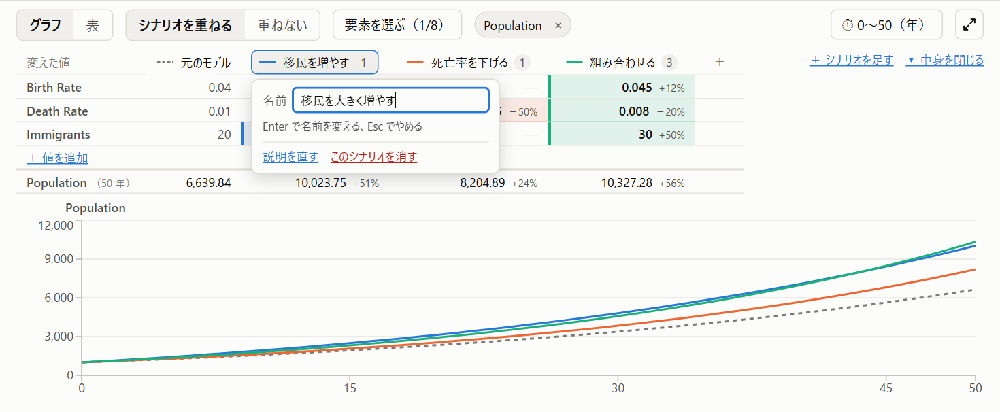

- **名前を変える：** 表の見出し（閉じているときは帯）のシナリオの名前を押すと、吹き出しが出ます。名前を書き換えて Enter で保存し、Esc でやめます。吹き出しの外を押しても、保存せずに閉じます。「元のモデル」と、ほかのシナリオと同じ名前は使えません。使えないときは、名前の欄の下に理由を出し、保存しません
- **シナリオを消す：** 吹き出しの「このシナリオを消す」で消します。表の行を消すときと同じく確認は出しませんが、黄色の帯で知らせ、Ctrl+Z（「元に戻す」）で戻せます
- **値を直す：** 表のマスを押して書き換えます。値は数字か式で入れます（例：`[Birth Rate]*2`）
- **シナリオを足す：** 帯の「＋ シナリオを足す」か、表の見出しの右端の「＋」で、表の右端に名前の欄を出します。名前を入れて Enter で保存し、値は保存してからマスに入れます。シナリオがまだないときは、グラフの上の「＋ シナリオを足す」を押すと、「元のモデル」だけの表が開いて、同じように足せます。「重ねない」にしているときは、「シナリオを重ねる」に切り替わって表が開きます。名前を付けずにやめる（Esc）と、「重ねない」に戻ります
- **8 つを超えるとき：** グラフに重ねられるシナリオは 8 つまでです。8 つあるときは「＋ シナリオを足す」を押せません（AI が 9 つ目からを保存したときは、グラフには出さず、そのことを凡例の下に出します。凡例の下の名前を押すと、同じ吹き出しで名前を変えたり消したりできます）

#### シナリオの説明を直す

説明には、どんなシナリオかを書きます。凡例のシナリオの名前にカーソルを乗せると出ます。吹き出しの「説明を直す」を押すと、左の欄が説明の編集欄になります（要素の「編集」と同じ場所です）。

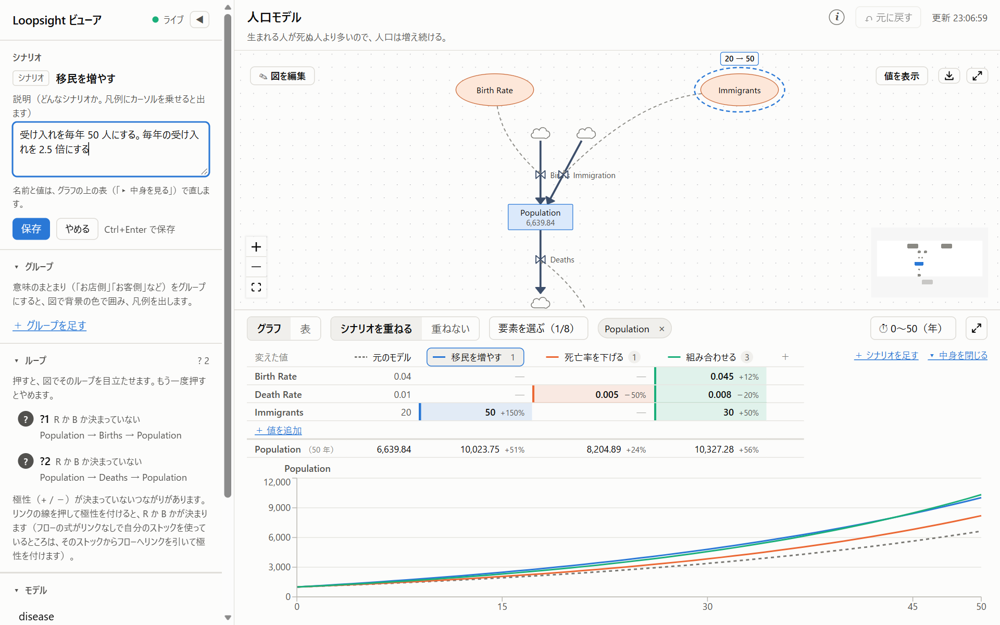

- **保存：** 「保存」か Ctrl+Enter で、モデルの `scenarios` に保存します。「やめる」か Esc で、保存せずに閉じます
- **直せるもの：** 左の欄で直せるのは説明だけです。名前と値は表で直します

名前の重なり、ない要素、値を変えられない要素は、AI が `set_scenarios` で保存したときと同じように確かめ、誤りがあれば保存せずに、直しているところ（表のマスや名前の欄、左の欄）に理由を出します。値の式の誤り（参照する名前の打ち間違いなど）は、保存したうえで、グラフの上に「実行できませんでした」と理由を出します。

### シミュレーションの設定を直す

グラフ・表の上の帯の右（広げるボタンの左）に、いまの期間を `⏱ 0〜100（年）` のように出しています。カーソルを乗せると、開始時刻・期間・刻み幅・解法をすべて出します。押すと、左の欄が設定の編集欄になります（要素の「編集」と同じ場所です）。モデルにエラーがあってグラフが出ないときは、「エラーがあるため実行できません」の横に同じボタンを出します。

- **直せるもの：** 開始時刻、期間（開始からどれだけ進めるか）、刻み幅、時間の単位（秒・分・時間・日・週・月・年）、解法（RK1：オイラー法、RK4：ルンゲ＝クッタ法）。AI の `set_simulation` で変えられるものと同じです
- **保存：** 「保存」か Ctrl+Enter で、モデルの `simulation` に保存します。変えた項目だけを保存し、すぐ実行し直してグラフと図の値が変わります。AI が `get_model` で読んでも同じ値が見えます。「閉じる」か Esc で閉じます（保存していない変更は捨てます）
- **確かめ：** AI が `set_simulation` で保存したときと同じように確かめます（期間と刻み幅は正の数、刻み幅は期間以下）。数でないときも含め、誤りがあれば保存せずに、その欄のすぐ下に理由を出します。全角で打った数字も読みます
- **実際のデータとの重なり：** 期間を変えて、実際のデータの時刻がシミュレーションの期間と重ならなくなったときは、左の「問題」に警告で出します（[実際のデータを重ねる](#実際のデータを重ねる)）
- [編集モード](#編集モード)に関係なく、いつでも直せます。「元に戻す」（Ctrl+Z）でも戻せます

### 値の見方の注意

- 縦軸は 1 本だけです。大きさの違う要素（人口と出生率など）を一緒に出すと、小さいほうは 0 の近くにつぶれて見えます。そのときは片方ずつ見るか、表で見てください
- 数字は、絶対値が 100 以上なら小数 2 桁まで、それより小さければ 4 桁までに丸めて出します。とても大きい値や小さい値は `1.234e+9` のような形になります

### 実際のデータを重ねる

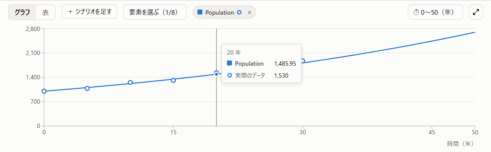

実際のデータ（売上の実績や観測値など）があると、グラフの要素の線に、同じ色の白抜きの丸で重ねて出します。モデルが、問題になっている振る舞いを再現できているかを見比べるのに使います。

- **データの置き場所：** 作業フォルダの `<モデル名>.data.csv` です。1 行目は見出しで、1 列目が時刻、ほかの列が要素名です。空欄は値なしとして扱います。モデルの一覧には出ません
- **取り込み方：** AI に「この CSV を実際のデータとして取り込んで」と頼みます（`import_data`）。Excel から貼った表（タブ区切り）でも読めます。ファイルを Excel などで直接書き換えて保存してもかまいません。画面はその場で変わります
- **値を読む：** データのある時刻にカーソルを乗せると、モデルの値の下に「実際のデータ」の値が出ます。凡例の名前の横の白抜きの丸は、その要素にデータがあることを示します
- **列名が要素名と合わないとき：** 左の「問題」に警告として出し、似た名前があれば「もしかして」を添えます。合わない列は描きません。時刻がシミュレーションの期間と重ならないときも知らせます（期間は[シミュレーションの設定](#シミュレーションの設定を直す)で直せます）
- **名前を変えたとき：** 要素の名前を変えると（AI に頼んでも、画面で変えても）、CSV の列名も直します（見出しの行だけを書き換え、値はそのまま残します）。「元に戻す」で名前を戻すと、列名も戻します。CSV を Excel などで開いていて直せなかったときは、名前の変更は保存したうえで、黄色の帯で知らせます。そのときは列名を手で直してください
- **シナリオを重ねているとき：** 要素ごとのグラフにも、データの点を重ねます。線の色はシナリオを表すので、点は文字と同じ色の白抜きの丸にします

## 要素の詳しい情報

図の要素を押すと、左の「選んだ要素」に詳しい情報が出ます。フローは、⋈（弁）か名前を押します。

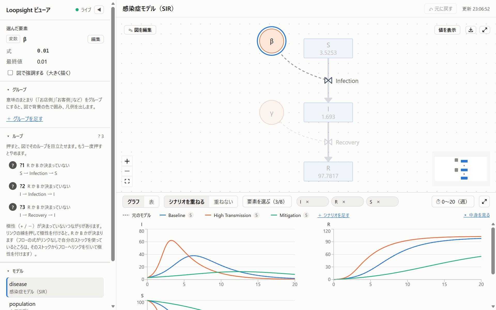

| 項目 | 内容 |
|---|---|
| 種類と名前 | ストック、変数、フローなど |
| 流れ | フローの出元と行き先（モデルの外は「（外）」） |
| 初期値 | ストックの最初の値（式のこともあります） |
| 式 / 流量 | 変数の式、フローの流量の式 |
| 入力・表 | コンバーターの入力と変換の表 |
| 単位 | 単位があれば |
| 最終値 | 実行の最後の値 |
| 極性 | 選んだリンク。「+」「−」「なし（決めない）」から選びます（[リンクの極性](#リンクの極性)） |
| 遅れの印（‖）を付ける | フローと、選んだリンク。チェックで付け外しします（[遅れの印](#遅れの印)） |

ストック、変数、コンバーターでは、表の下に「図で強調する（大きく描く）」が出ます（[大事な要素を強調する](#大事な要素を強調する)）。

## 要素を編集する

選んだ要素の「編集」を押すと、左の欄で値を直せます。直せるのはストック、変数、フロー、コンバーターです。[編集モード](#編集モード)に関係なく、いつでも使えます。

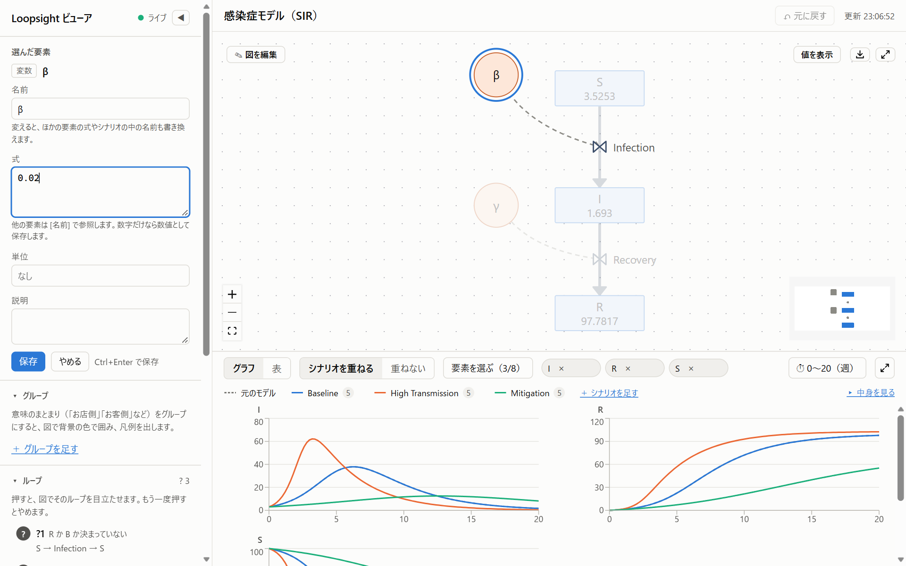

| 要素 | 直せる項目 |
|---|---|
| ストック | 名前、初期値、単位、負にしない、説明 |
| 変数 | 名前、式、単位、説明 |
| フロー | 名前、流量、単位、負にしない、説明 |
| コンバーター | 名前、表（1 行に「入力, 出力」）、単位、説明 |

- 式の中では、ほかの要素を `[名前]` で参照します（例：`[Population]*[Birth Rate]`）。数字だけなら数値として保存します。式の書き方と使える関数は、[式の書き方](reference/formulas.md)にまとめています
- 「保存」か Ctrl+Enter で保存します。「やめる」か Esc で、直す前に戻ります
- 保存すると、すぐにモデルを実行し直して、図の最終値とグラフが変わります
- 式で新しい要素を参照すると、足りないリンク（点線の矢印）を自動で足します。AI が `upsert_elements` で直したときと同じです
- 式に誤りがあっても保存はします。左の「問題」にエラーが出るので、直してください
- 名前を変えると、ほかの要素の式、シナリオの中の名前、実際のデータの列名も書き換えます。選んでいる要素や線、グラフに出している要素は、新しい名前のまま続きます。図の見る場所も動かしません。「元に戻す」で、名前と書き換えた参照をまとめて戻せます
- ほかの要素と同じ名前（大文字と小文字の違いだけのものも含む）には変えられません。そのときは、欄の下にエラーが出ます

要素を足す・消す、線（リンク）を引く・消すのは、[編集モード](#編集モード)でできます。シナリオは画面で足したり直したりできます（[シナリオを直す](#シナリオを直す)）。

## 編集モード

図の形を変える操作は、図の左上の「✎ 図を編集」をオンにしたときだけできます。見るだけのときに、うっかり図を崩さないためです。値やシナリオ、シミュレーションの設定は入力欄に打ち込んで直すので、うっかり変わることはまずなく、「元に戻す」でも戻せます。そのため、オフのままでもいつでも直せます。

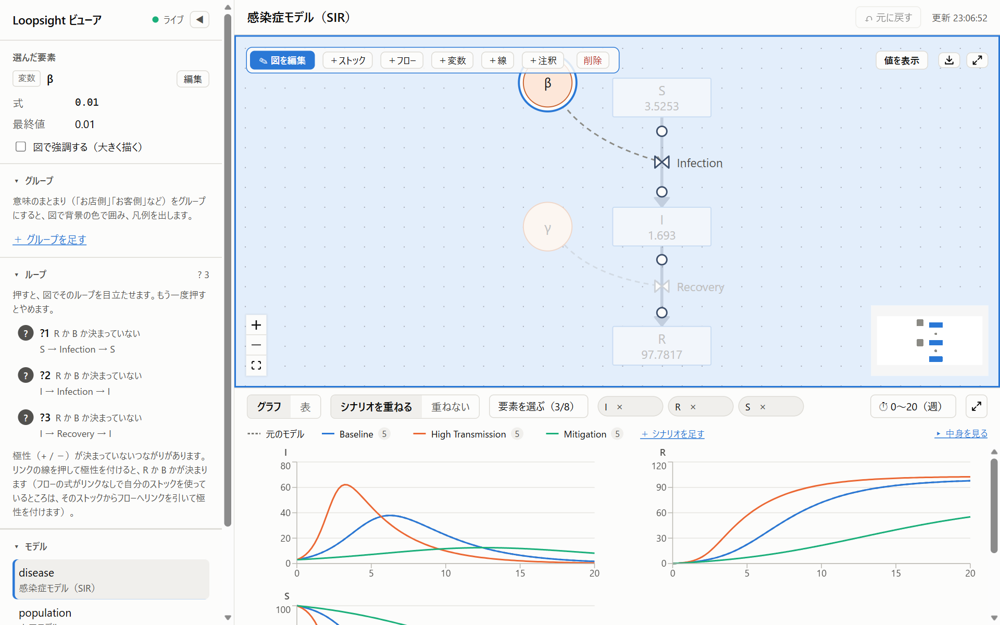

| | できること |
|---|---|
| いつでも | 要素や線を選ぶ、見る場所を動かす・拡大縮小する、要素の中身（値や名前）を直す（左の「編集」）、シナリオを直す、シミュレーションの設定を直す、元に戻す |
| 編集モードのときだけ | 図の要素や注釈を動かす（[図の要素を動かす](#図の要素を動かす)）、要素や注釈を足す・消す、線（リンク）を引く・消す、フローの端をつなぎ替える |

- 押すたびにオンとオフが切り替わります。オンの間は図の窓の色が変わって縁が付き、「✎ 図を編集」の横に、要素を足す・線を引く・消すボタンが出ます。要素が図の左上の角にあるモデルでは、「✎ 図を編集」のボタン（オフのときも出ています）や、オンのときの帯が要素に重なることがあります。帯は少し透けているので下の要素も見えますが、見にくければ見る場所を動かします
- ビューアを開いたときは、いつもオフです（前に開いたときの状態は覚えません）
- AI の変更は、編集モードに関係なく、その場で画面に出ます
- AI が使う図だけの表示（`view_diagram`）には出ません。図の要素は動かせません

### 要素を足す

図の左上の「＋ストック」「＋フロー」「＋変数」を押してから、図の置きたい場所を押します。その場所に「新しいストック」のような仮の名前で置き、選んだ状態にします（同じ名前があれば「新しいストック 2」のように番号を付けます）。値は 0 です。名前や式は、左の「編集」で直します。

- ボタンを押したあと、置きたい場所を押すまでは、ボタンの色が変わり、カーソルが十字になります。やめるときは Esc を押すか、同じボタンをもう一度押します
- フローは、両端を雲（モデルの外）にして横向きに置きます。端をストックにつなぐときは、[フローの端をつなぎ替える](#フローの端をつなぎ替える)を見てください
- 足した要素はすぐにファイルに保存するので、AI からも見えます。AI の編集（`upsert_elements`）と同じ確かめを通ります
- 足したり消したり（それを元に戻したり）しても、図の見る場所は動かしません。AI が要素を足したり消したりしたときは、全体が入るように合わせ直します

### 要素を消す

図で要素を選んでから、図の左上の「削除」を押すか、Delete キー（Mac は fn + delete）を押します。文字を消すつもりで押されやすい Backspace（Mac の delete）では消しません。

- つながっているリンクも一緒に消えます
- ストックを消すと、出入りするフローは残し、その端を雲（モデルの外）にします。雲は消したストックのあった場所に置きます（入るフローと出るフローの雲が重ならないよう、それぞれのフローの向きに少しずらします）。フローも消したいときは、続けてフローを選んで消します
- フローを消すと、両端の雲と弁も消えます
- 消した要素をほかの要素の式が使っていた、シナリオで値を変えていた、といったときは、何をしたかを黄色の帯で知らせます。シナリオの中の、その要素の値は消えます。式は直さないので、左の「問題」にエラーが出ます。式を直すか、「元に戻す」で戻します（戻すと帯も閉じます）
- 実際のデータの列はそのまま残します。合わなくなったところは、左の「問題」に警告が出ます（元に戻せば合います）
- 選んでいない、左の欄でシナリオの説明を直している、のどちらかのときは、「削除」は押せません
- 線（リンク）を消すときは、[線（リンク）を引く・消す](#線リンクを引く消す)を見てください
- 左の欄（詳細欄の入力欄や「保存」のボタンなど）にいるときの Delete キーでは消しません。打ちかけの内容を失わないためです
- AI の削除（`remove_elements`）と同じ処理を通ります。「元に戻す」で戻せます

### 線（リンク）を引く・消す

リンク（点線の矢印）は、「この要素の値を、矢印の先の式で使う」というつながりです。編集モードで、次のどちらかの方法で引きます。

- **ドラッグ：** 元の要素の縁（箱や丸のすぐ外側）にマウスを乗せると、縁に色が付き、カーソルが十字になります。そこからドラッグして、先の要素の上で離します。引いている間は点線が付いてきて、離せる要素には枠が付きます。何もないところで離すと、何も引きません。フロー（⋈）から引くときは、下の「＋線」を使います
- **[＋線]：** 図の左上の「＋線」を押してから、元の要素 → 先の要素の順に押します。元の要素には点線の枠が付きます。やめるときは Esc を押すか、何もないところを押します

引いたリンクはすぐにファイルに保存し、選んだ状態にします。AI の編集（`upsert_elements` で LINK を足す）と同じ処理を通ります。

- フローにつなぐときは、⋈（弁）に向けて引きます。雲（モデルの外）にはつなげません
- 同じ向きのリンクがすでにあるとき、自分自身に引こうとしたときは、引かずに理由を黄色の帯で知らせます。逆向きのリンクは別のリンクなので引けます
- 極性（`+` `-`）は、引いたあとに左の欄で付けます（[リンクの極性](#リンクの極性)）
- 式で使う要素のリンクは、式を保存したときに自動で足されます（[要素を編集する](#要素を編集する)）。画面で引くのは、式を書く前につながりを描いておくときなどです

編集モードの間は、要素の縁が線を引き始める場所になります。線の端（矢じりや、ストックに出入りする管）が要素の縁に重なるところを押すと、線ではなく要素が選ばれます。線は、端から少し離れたところを押して選びます。

消すときは、リンクの線を押して選んでから、図の左上の「削除」を押すか、Delete キーを押します。「元に戻す」で戻せます。

- 先の要素の式が元の要素を使っている（`[元の要素]` と書いてある）リンクは消せません。消すと式がエラーになり、次に要素を直したときに自動で付け直されるためです。コンバーターの入力元からのリンクも消せません。選んだときに左の欄に理由が出て、「削除」は押せません。先に式（入力）を直します

### 注釈を置く

図の左上の「＋注釈」を押してから、図の置きたい場所を押します。その場所に「注釈」という仮の文字で置き、選んだ状態にします（id は「注釈1」「注釈2」…のように付けます）。

- 文字は、左の「編集」で直します（Ctrl+Enter で保存）。改行で行を分けられます。文字の編集は、編集モードに関係なくいつでもできます
- 動かすときは、要素と同じくドラッグします（[図の要素を動かす](#図の要素を動かす)）
- 消すときは、注釈を押して選んでから、図の左上の「削除」を押すか、Delete キーを押します
- どれもすぐにファイルに保存し、「元に戻す」で戻せます。AI の `set_annotations` と同じ処理を通ります

### フローの端をつなぎ替える

編集モードの間は、フローの管の両端の近く（雲やストックの少し手前）に、小さな丸（つまみ）が出ます。つまみをドラッグして離すと、その端をつなぎ替えます。

- **ストックの上で離す：** その端をストックにつなぎます。ドラッグしている間は弁から点線が付いてきて、離せるストックには枠が付きます。やめるときは、離す前に Esc を押します
- **何もないところで離す：** その端をストックから外し、離した場所に雲（モデルの外）を置きます。もとから雲なら、雲をそこに動かします
- 変数や弁の上で離したとき、両端を同じストックにしようとしたときは、つなぎ替えずに理由を黄色の帯で知らせます
- 端と雲の位置はすぐにファイルに保存します。AI の編集（`upsert_elements` でフローの `from` / `to` と雲の座標を変える）と同じ処理を通ります。「元に戻す」で戻せます

## 図の要素を動かす

[編集モード](#編集モード)をオンにすると、ストック、変数、コンバーター、雲（モデルの外）、注釈をドラッグで動かせます。マウスを離すと、その位置をファイルに保存します。

- フローの ⋈（弁）は、両端の真ん中についてきます。弁だけを動かすことはできません
- 座標のない要素があるモデル（AI が作ったばかりのモデルなど）で動かすと、見えている配置をまとめて保存します
- 要素を図の左や上の端より外に動かすと、全体をずらして保存します。負の座標や、左上の余白より外の座標を残さないためです。注釈も同じだけずらします

## 元に戻す

上の帯の「↶ 元に戻す」か Ctrl+Z（Mac は ⌘Z）で、画面で変えたことを 1 つずつ元に戻せます。式や名前の変更も、リンクの極性の付け外しも、要素や注釈の移動も、要素や注釈を足す・消すことも、シナリオの変更（足す・直す・消す）も、シミュレーションの設定の変更も戻せます。編集モードに関係なく使えます。要素の名前を戻すと、式・シナリオ・実際のデータの列名も戻します。

- 戻せるのは、この画面（ビューア）で変えたことだけです。AI が変えたことは戻せません（AI に頼みます）
- 画面で変えたあとに AI がモデルを変えていたら、戻しません。AI の変更を消してしまわないためです。そのときは、そのことを知らせます
- 覚えておくのは、モデルごとに 50 回分です。ビューアを起動し直すと、元に戻せる記録は消えます
- 入力欄で打っているあいだの Ctrl+Z は、入力欄の文字を戻します

## AI と同時に変えたとき

画面と AI が同じモデルを同時に変えても、片方の変更が黙って消えることはありません。

- **画面で保存したときに、AI が先にファイルを変えていたとき：** 保存せずに最新の内容を読み直し、上に黄色の帯で知らせます。変わった要素には橙色の枠が付きます。内容を確かめてから、もう一度直してください
- **編集しているあいだに、AI が同じ要素を変えたとき：** 「保存」を押すと、保存せずに「編集しているあいだに、ほかのところ（AI など）でこの要素が変わりました」と知らせ、いまの値を出します。それでも自分の内容にしたいときは、もう一度「保存」を押すと上書きします
- **編集しているあいだに、AI がほかの要素を変えたとき：** そのまま保存できます。AI の変更も残ります
- **シナリオを直しているときも同じです：** AI が先にファイルを変えていたら黄色の帯で知らせます。表のマスや左の欄の説明を直しているあいだに、AI が同じ値や説明を変えていたら、そのことを知らせます。もう一度確定する（説明は「保存」を押す）と上書きします
- **シミュレーションの設定を直しているときも同じです：** AI が先にファイルを変えていたら黄色の帯で知らせます。左の欄で設定を直しているあいだに、AI が設定を変えていたら、「保存」を押したときにそのことといまの設定を知らせ、直していない欄はいまの設定にします。もう一度「保存」を押すと、直した欄だけを上書きします（AI が変えたほかの項目は残ります）。まだ欄を何も直していなければ、AI が変えた設定（や「元に戻す」で戻した設定）をそのまま欄に出します

## AI の変更がその場で反映される

AI が MCP でモデルを保存すると、すぐに画面が変わります。変わった要素や増えた要素は、2〜3 秒のあいだ**橙色の枠**で示します。図の見えている範囲は、要素が増えたり減ったりしたときだけ合わせ直します。値が変わっただけなら、拡大や位置はそのままです。

下は、AI に「出生率を 4% にして、毎年 20 人の移民を足して」と頼んだあとの画面です。変えた Birth Rate と、新しく足した Immigrants と Immigration に枠が付いています。グラフと、ストックの最終値も新しい結果に変わっています。

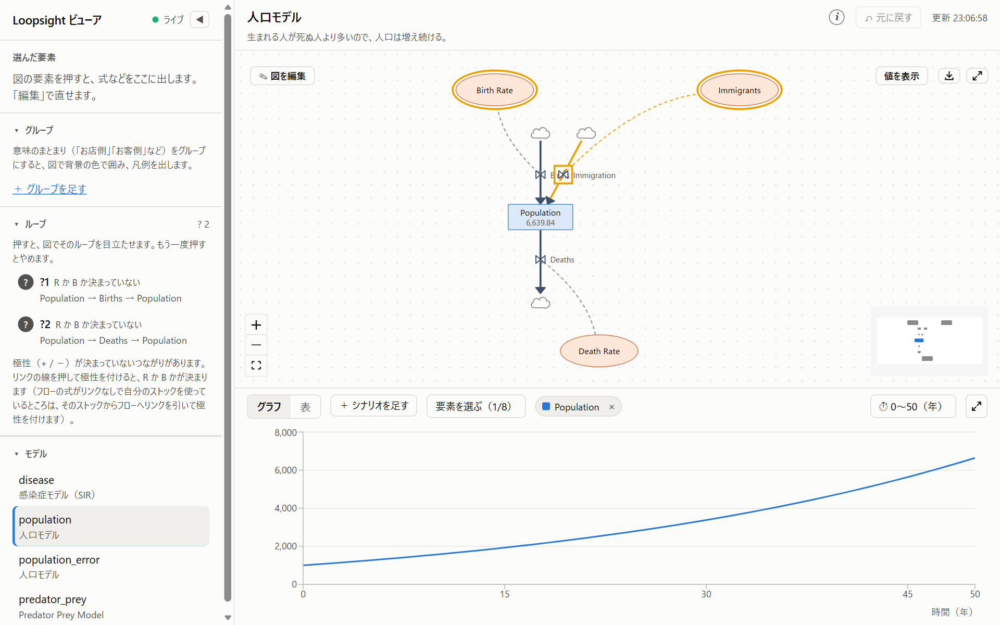

メモ帳などでファイルを直接書き換えたときも、同じように反映されます。

## エラーがあるとき

モデルにエラーがあると、左に「問題」が出ます。エラーがあるあいだは実行しないので、グラフは出ません。図は、エラーがあっても描きます。

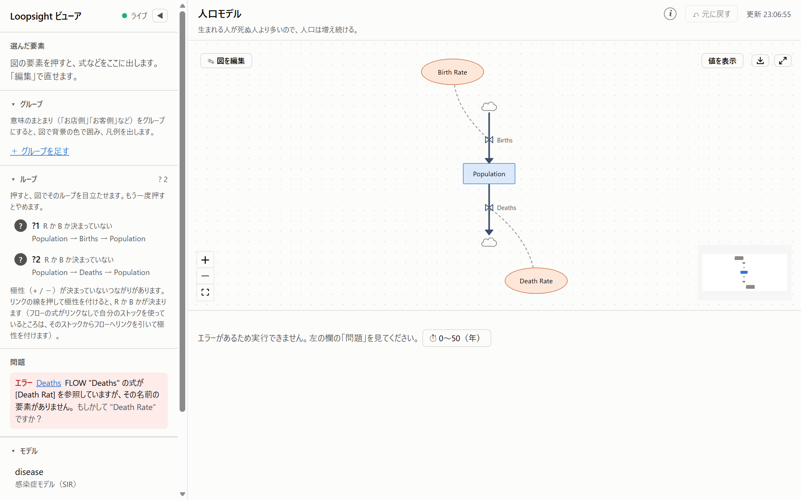

- **エラー（赤）：** このままでは実行できない問題です。式の名前の打ち間違いなどです。「もしかして」のあとに、直し方の候補が出ることがあります
- **警告（黄）：** 実行はできるが、確かめたほうがよいことです
- **要素の名前（下線つき）：** 押すと、その要素を選んで詳しい情報を出します

直すときは、エラーの内容を AI に伝えて頼みます。AI もツールの結果で同じエラーを受け取っているので、たいていは自分で直します。直してファイルが保存されると、「問題」は消えてグラフが出ます。

## 暗い配色

パソコンの設定が暗い配色（ダークモード）なら、画面も暗い配色になります。切り替えのボタンはなく、OS やブラウザの設定に合わせます。

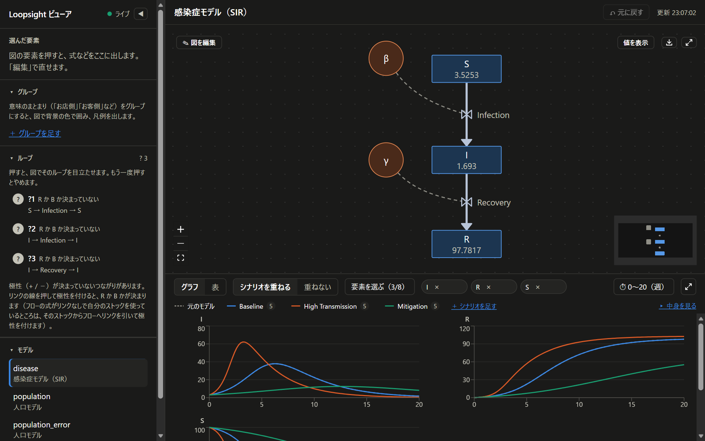

## 困ったとき

| 症状 | 確かめること |
|---|---|
| 「画面がビルドされていません」と出る | clone して使っているときに出ます。`npm run build` を実行してから、もう一度 `npm run viewer` を起動します |
| 「モデルがありません」と出る | 作業フォルダが合っているか、起動したときの表示で確かめます。MCP サーバーと同じフォルダを指定します |
| 「ファイルが見つかりません」と出る | 開いているモデルのファイルが、エクスプローラーや AI に動かされたか消されました。左下の「モデル」の一覧から選び直します |
| 左上が「未接続」になる | ビューアが止まっています。起動し直して、ブラウザを再読み込みします |
| AI が変えたのに画面が変わらない | ビューアと MCP サーバーの作業フォルダが同じか確かめます。左上が「ライブ」か確かめます |
| ポートが使われていて起動しない | ビューアがもう起動していれば、http://localhost:5180/ を開きます。別のポートで起動するときは、`--port 5181` を付けます |
| PowerShell で「スクリプトの実行が無効」と出て `npx` が止まる | `npx` の代わりに `npx.cmd` と打ちます（[はじめての手順](getting-started.md#よくある失敗と直し方)） |
| 図が画面からはみ出している | 左下の `⛶` を押すと、全体が入るように戻ります。大きな図は名前が読める大きさまでしか縮めないので、残りは右下のミニマップで動かして見ます |
| 古い画面のまま | ブラウザを再読み込み（Ctrl+R）します |
| 保存したら黄色の帯が出た | 画面より先に AI などがモデルを変えていました。最新の内容を確かめて、もう一度直します（[AI と同時に変えたとき](#ai-と同時に変えたとき)） |
| 図の要素をドラッグしても動かない | 図の左上の「✎ 図を編集」をオンにします（[編集モード](#編集モード)） |
| リンクを選んでも「削除」が押せない | 先の要素の式が元の要素を使っているか、コンバーターの入力です。左の欄に理由が出ます。先に式を直します（[線（リンク）を引く・消す](#線リンクを引く消す)） |
| 「元に戻す」が押せない | 画面で変えたことがないか、ビューアを起動し直したあとです。AI の変更は戻せません |

## できないこと

- シナリオの値を、保存せずにその場で動かして試すこと（シナリオは保存してから、グラフで比べます）
- モデルにエラーがあって実行できないときに、シナリオを足したり直したりすること（グラフが出ないので、シナリオの編集の入口もありません。先にエラーを直します）
- ほかの PC やスマートフォンから開くこと
- エージェントベースのモデルを見ること（ModelJSON で表せないため、取り込めません）。状態（STATE）と遷移（TRANSITION）を含むモデルも開けません（システムダイナミクスのモデルだけを扱います）。開くと、どの要素が対応していないかをエラーで知らせます

## このページのスクリーンショットを撮り直す

画面を変えたら、次のコマンドでこのページの画像を撮り直せます。Edge か Chrome が必要です（場所は環境変数 `BROWSER_PATH` でも指定できます）。

```bash
npm run build
npm run screenshots
```

[scripts/viewer-screenshots.mjs](../scripts/viewer-screenshots.mjs) が、見本のモデルを一時フォルダに作り、ビューアを起動し、ブラウザをヘッドレスで動かして撮ります。画像は `docs/images/viewer/` に上書きされます。作業フォルダの `models/` には触りません。撮る場面を足したいときは、このスクリプトに足します。
